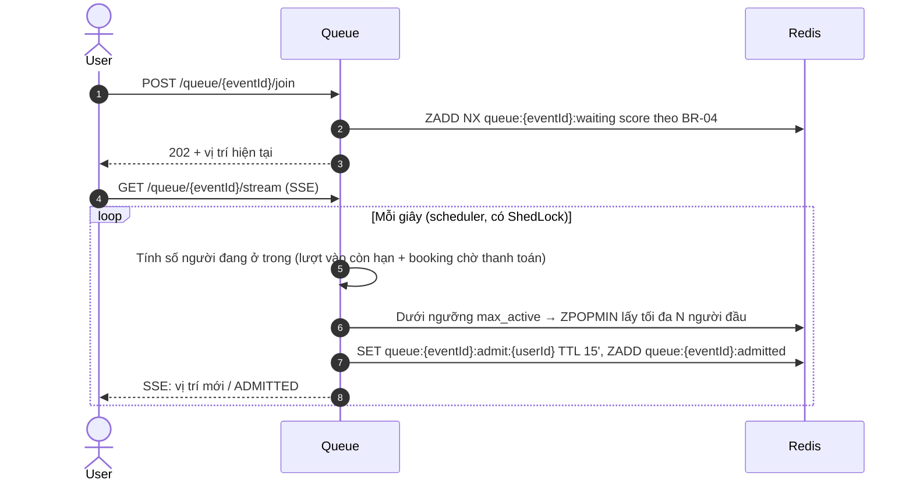
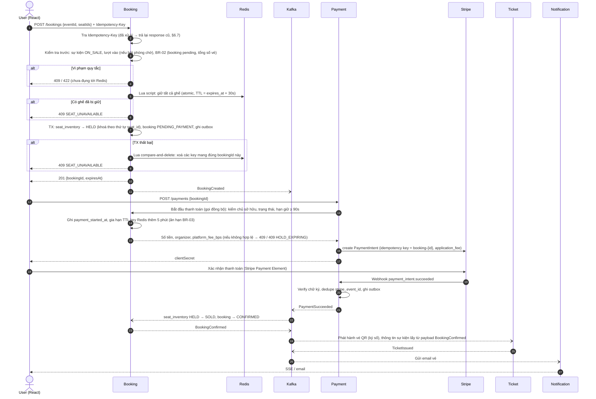

# Ticket Hub — Tài liệu thiết kế hệ thống

> Nền tảng bán vé sự kiện / concert có flash sale, hỗ trợ marketplace (ban tổ chức bán vé, nền tảng thu phí).
> Mục tiêu học tập: xây dựng **và vận hành** một hệ thống ở mức production — từ code đến scale, giám sát, xử lý sự cố.

| Thông tin | Giá trị |
|---|---|
| Trạng thái | Bản thiết kế |
| Cập nhật | 19/10/2026 |
| Backend | Java 21 · Spring Boot · REST API |
| Frontend | React · TypeScript · shadcn/ui |
| Ràng buộc | Dự án cá nhân, chi phí ~0$, hoàn thành trước 18/12/2026 (§25) |

---

## Mục lục

1. [Tổng quan](#1-tổng-quan)
2. [Actors & chức năng](#2-actors--chức-năng)
3. [Quy tắc nghiệp vụ](#3-quy-tắc-nghiệp-vụ)
4. [Kiến trúc tổng thể](#4-kiến-trúc-tổng-thể)
5. [Services & quyền sở hữu dữ liệu](#5-services--quyền-sở-hữu-dữ-liệu)
6. [Mô hình dữ liệu](#6-mô-hình-dữ-liệu)
7. [Luồng nghiệp vụ chính](#7-luồng-nghiệp-vụ-chính)
8. [Thiết kế Event (Kafka)](#8-thiết-kế-event-kafka)
9. [Thiết kế Redis](#9-thiết-kế-redis)
10. [Chống oversell (Concurrency)](#10-chống-oversell-concurrency)
11. [Thiết kế API](#11-thiết-kế-api)
12. [Realtime (SSE)](#12-realtime-sse)
13. [Bảo mật](#13-bảo-mật)
14. [Frontend](#14-frontend)
15. [Resilience](#15-resilience)
16. [Observability](#16-observability)
17. [Scaling](#17-scaling)
18. [Dữ liệu: HA, backup & khôi phục](#18-dữ-liệu-ha-backup--khôi-phục)
19. [Triển khai & môi trường](#19-triển-khai--môi-trường)
20. [Kiểm thử](#20-kiểm-thử)
21. [Tech stack](#21-tech-stack)
22. [Cấu trúc repository](#22-cấu-trúc-repository)
23. [AWS & kiểm soát chi phí](#23-aws--kiểm-soát-chi-phí)
24. [Quyết định kiến trúc (ADR)](#24-quyết-định-kiến-trúc-adr)
25. [Lộ trình](#25-lộ-trình)

---

## 1. Tổng quan

### 1.1. Bài toán

Bán vé concert là bài toán có tải **cực kỳ không đều**: ngày thường gần như không có traffic, nhưng khi mở bán một concert hot, hàng nghìn người cùng tranh vài trăm ghế trong vài giây. Hệ thống phải:

- **Không bao giờ bán 1 ghế cho 2 người** (oversell) — đây là bất biến số 1.
- **Không mất tiền / không mất đơn**: đã trừ tiền thì phải có vé, hoặc được hoàn tiền tự động.
- **Chịu được đột biến tải** bằng hàng đợi ảo + auto-scaling, và **co lại** khi rảnh để tiết kiệm chi phí.
- **Chết từng phần chứ không chết toàn bộ** khi một thành phần (DB, Redis, Stripe…) gặp sự cố.

### 1.2. Phạm vi

| Trong phạm vi | Ngoài phạm vi |
|---|---|
| Sự kiện có ghế ngồi theo sơ đồ (seated) | Vé đứng không đánh số (general admission) |
| Phòng chờ ảo khi flash sale | Mobile app native (dùng web responsive + PWA) |
| Thanh toán thẻ qua Stripe (test mode) | Ví điện tử VN (MoMo, VNPay…) |
| Marketplace: ban tổ chức nhận tiền qua Stripe Connect | Chuyển nhượng / bán lại vé |
| Vé điện tử QR có chữ ký số, check-in tại cổng | Tích hợp phần cứng cổng soát vé |
| Hoàn vé theo chính sách | Xử lý tranh chấp (dispute) tự động |
| Check-in online, organizer tự quét vé | Check-in khi mất mạng; vai trò nhân viên soát vé riêng |
| Phí nền tảng theo % giá vé | Gói thuê bao cho organizer (giảm phí nền tảng) |
| Sửa thông tin hiển thị của sự kiện đã publish | Dời lịch, đổi địa điểm hay giá của sự kiện đã publish (thay bằng huỷ và tạo sự kiện mới) |

---

## 2. Actors & chức năng

| Actor | Chức năng |
|---|---|
| **Guest** | Xem / tìm kiếm sự kiện, xem sơ đồ ghế |
| **Customer** | Vào phòng chờ, chọn ghế, huỷ booking đang giữ ghế để chọn lại, thanh toán, nhận vé QR (email + trong app), xem lịch sử đơn, yêu cầu hoàn vé |
| **Organizer** | Đăng ký làm ban tổ chức, kết nối Stripe (nhận tiền), tạo sự kiện, gán hạng vé cho khu ghế, cấu hình giờ mở bán, xem doanh thu realtime, quét vé check-in |
| **Admin** | Xem / tìm người dùng, khoá / mở khoá tài khoản, duyệt / đình chỉ organizer, tạm dừng hoặc huỷ sự kiện, quản lý địa điểm & sơ đồ ghế, cấu hình phí nền tảng, xem trạng thái cấu hình thanh toán (chỉ đọc: chế độ Stripe, webhook, event gửi lỗi; secret không hiển thị), xem audit log, hoàn tiền thủ công, bật/tắt feature flag |
| **Hệ thống** | Hết hạn giữ ghế, đối soát thanh toán với Stripe, gửi thông báo (email và hộp thư trong app cho cả 3 vai trò) |

---

## 3. Quy tắc nghiệp vụ

| Mã | Quy tắc |
|---|---|
| BR-01 | Một ghế của một sự kiện chỉ được bán cho **đúng 1** booking ở trạng thái CONFIRMED |
| BR-02 | Mỗi booking tối đa **6 ghế**; mỗi user tối đa **1 booking đang chờ thanh toán** cho mỗi sự kiện; **tổng số vé** của một user cho một sự kiện (cộng mọi booking `PENDING_PAYMENT` và `CONFIRMED`) không vượt `max_tickets_per_user` do organizer đặt cho sự kiện, mặc định **6** |
| BR-03 | Ghế được **giữ 10 phút** kể từ khi tạo booking; quá hạn chưa thanh toán → tự động nhả ghế. Không cho **bắt đầu** thanh toán khi thời gian giữ còn **dưới 90 giây**. Booking đã bắt đầu thanh toán trước hạn được **ân hạn thêm 5 phút** (cấu hình được) rồi mới bị nhả ghế |
| BR-04 | Phòng chờ chỉ bật cho sự kiện được đánh dấu `high_demand` (hoặc qua feature flag); user được gọi vào chọn ghế nhận một **lượt vào (admission) hạn 15 phút**. Mỗi lượt vào chỉ tạo được **1 booking**; muốn mua tiếp phải xếp hàng lại. Phòng chờ mở **15 phút trước** giờ mở bán: người vào trong khoảng này được xếp thứ tự **ngẫu nhiên**, người vào sau giờ mở bán xếp theo thời điểm vào |
| BR-05 | Organizer chỉ được publish sự kiện khi đã được Admin duyệt **và** tài khoản Stripe Connect đã `charges_enabled` |
| BR-06 | Phí nền tảng mặc định **5%** giá vé (application fee), cấu hình được bởi Admin. Mức phí được **chốt vào sự kiện lúc publish** và áp cho mọi vé của sự kiện đó; đổi mức phí chỉ áp cho các sự kiện publish sau đó |
| BR-07 | Hoàn vé được phép đến **48 giờ trước giờ diễn**, theo **cả booking** (không hoàn từng vé). Khách nhận lại số tiền đã trả **trừ phí nền tảng**; phí nền tảng không hoàn (vé 1.000.000đ, phí 5% → hoàn 950.000đ). Checkout hiển thị rõ phần phí nền tảng kèm ghi chú "không hoàn lại" |
| BR-08 | Sự kiện bị huỷ → tự động hoàn **100%** số tiền đã trả cho mọi booking `CONFIRMED`, **kể cả phí nền tảng**; không áp dụng mốc 48 giờ của BR-07. Chỉ **Admin** được huỷ sự kiện. Booking đang `PENDING_PAYMENT` bị huỷ theo; thanh toán của chúng đến sau đó được hoàn 100% |
| BR-09 | Một vé chỉ được check-in **1 lần**. Vé bị thu hồi (`REVOKED`) **ngay khi khách gửi yêu cầu hoàn**, không chờ tiền hoàn xong; yêu cầu hoàn không huỷ được |
| BR-10 | Tiền lưu dạng **số nguyên đơn vị nhỏ nhất** (`amount_minor` BIGINT) + mã tiền tệ (mặc định **VND**, zero-decimal — xem ghi chú tiền tệ dưới bảng); không dùng float/double |
| BR-11 | Thời gian lưu **UTC** (`timestamptz`), hiển thị theo `Asia/Ho_Chi_Minh` |
| BR-12 | Customer được **tự huỷ** booking đang `PENDING_PAYMENT` để nhả ghế ngay (→ `CANCELLED`). Nếu thanh toán thành công đến sau khi đã huỷ thì xử lý như nhánh "thanh toán thành công nhưng booking đã hết hạn" (§7.3) |
| BR-13 | Organizer bị `SUSPENDED` hoặc tài khoản Stripe Connect mất `charges_enabled` → mọi sự kiện đã publish và chưa kết thúc của organizer đó **tự động tạm dừng bán** (`SUSPENDED`); vé đã bán giữ nguyên. Admin cũng được **tạm dừng thủ công** một sự kiện, kèm lý do (vd. nghi gian lận, sự cố khi mở bán). Admin quyết định mở bán lại hoặc huỷ sự kiện (BR-08) |
| BR-14 | Sau khi publish, organizer chỉ sửa được **thông tin hiển thị**: tiêu đề, mô tả, ảnh banner, danh mục. Giờ diễn, giờ mở bán, địa điểm, sơ đồ ghế, hạng vé và giá, `max_tickets_per_user` bị khoá. Sự kiện cần dời lịch thì Admin huỷ (BR-08) và organizer tạo sự kiện mới |

**Ghi chú tiền tệ.** Stripe chạy ở test mode với tài khoản platform đăng ký tại quốc gia Stripe hỗ trợ (vd. Singapore), vì Stripe chưa hỗ trợ merchant Việt Nam ở live mode. VND là **zero-decimal currency**: `amount_minor` là số đồng (50.000đ → `50000`, không nhân 100). Phí nền tảng làm tròn xuống về số nguyên. Không viết code giả định tiền có 2 chữ số thập phân.

---

## 4. Kiến trúc tổng thể

### 4.1. Sơ đồ

```
                         ┌───────────────────────────────┐
  Browser                │  React SPA (shadcn)           │
  ───────────────────────│  Host: nginx / S3+CloudFront  │
                         └───────────────┬───────────────┘
                                         │ HTTPS, session cookie (HttpOnly)
                                         │ cùng domain: /  → SPA, /api → Gateway
                         ┌───────────────▼───────────────┐        ┌────────────┐
                         │  Gateway / BFF                │◀──────▶│  Keycloak  │
                         │  Spring Cloud Gateway         │  OIDC  │  (IdP)     │
                         │  • login, giữ token           │        └────────────┘
                         │  • token relay, rate limit    │
                         │  • session trong Redis        │
                         └───────────────┬───────────────┘
                                         │ REST + JWT
     ┌──────────────┬──────────────┬─────┴────────┬──────────────┬────────────────┐
     ▼              ▼              ▼              ▼              ▼                ▼
┌─────────┐   ┌──────────┐   ┌──────────┐   ┌──────────┐   ┌──────────┐   ┌──────────────┐
│ Catalog │   │  Queue   │   │ Booking  │   │ Payment  │   │  Ticket  │   │ Notification │
└────┬────┘   └────┬─────┘   └────┬─────┘   └────┬─────┘   └────┬─────┘   └──────┬───────┘
     │             │              │              │  ▲           │                │
     │             │              │              │  │ webhook   │                │
     │             │              │              ▼  │           │                │
     │             │              │          ┌────────┐         │                │
     │             │              │          │ Stripe │         │                │
     │             │              │          └────────┘         │                │
═════╧═════════════╧══════════════╧══════════════╧══════════════╧════════════════╧═════
                     Kafka (KRaft) + Schema Registry + Debezium (outbox CDC)
═════════════════════════════════════════════════════════════════════════════════════

 Lưu trữ:  PostgreSQL (mỗi service 1 database)  ·  Redis  ·  Elasticsearch  ·  S3 (S3Mock khi dev)
 Nền tảng: Vault · Unleash · Prometheus/Grafana · ELK · Jaeger
```

### 4.2. Nguyên tắc thiết kế

| # | Nguyên tắc | Ý nghĩa |
|---|---|---|
| P1 | **Database per service** | Không service nào truy cập DB của service khác. Cần dữ liệu của nhau → nhận qua event và lưu bản sao (projection) |
| P2 | **Async-first** | Gọi đồng bộ chỉ khi user đang chờ kết quả. Còn lại giao tiếp qua event (in-process ở modular monolith, Kafka khi tách service) |
| P3 | **Outbox pattern** | Ghi dữ liệu nghiệp vụ và event trong **cùng 1 transaction** → không bao giờ "lưu DB xong mà quên gửi event" |
| P4 | **Idempotent everywhere** | Mọi consumer, mọi API tạo mới, mọi lệnh gọi Stripe đều chịu được việc bị gọi lặp |
| P5 | **Stateless services** | Không giữ state trong RAM của pod (session ở Redis) → scale-out/in tự do |
| P6 | **Fail-closed cho tồn kho** | Khi không chắc chắn ghế còn trống → từ chối bán, thà mất 1 đơn còn hơn oversell |
| P7 | **Modular monolith trước, tách sau** | Giai đoạn đầu các service là **module** trong 1 ứng dụng (Spring Modulith); ranh giới module trùng với ranh giới service nên tách ra không phải đập đi làm lại |
| P8 | **Observable by default** | Mọi request có `traceId` xuyên suốt log, metric, trace |

### 4.3. Hình thái triển khai

```
Giai đoạn 1 — Modular monolith          Giai đoạn 2 — Microservices
┌──────────────────────────────┐         ┌─────────┐ ┌─────────┐ ┌─────────┐
│ backend (app)                │         │ catalog │ │ booking │ │ payment │ ...
│  ├─ catalog   (module)       │  ───▶   └─────────┘ └─────────┘ └─────────┘
│  ├─ booking   (module)       │         mỗi service 1 deployable, 1 database
│  ├─ payment   (module)       │
│  └─ ...                      │
│ event nội bộ: Spring Modulith│
│ 1 Postgres, mỗi module 1 schema
└──────────────────────────────┘
```

---

## 5. Services & quyền sở hữu dữ liệu

| Service | Trách nhiệm | Sở hữu dữ liệu | Lưu trữ |
|---|---|---|---|
| **Gateway (BFF)** | Đăng nhập OIDC, giữ token, định tuyến, rate limit | Session | Redis |
| **Catalog** | Organizer profile, địa điểm, sơ đồ ghế, sự kiện, hạng vé, tìm kiếm | organizers, venues, seat_maps, seats, events, ticket_tiers | Postgres, Elasticsearch (projection), S3 (ảnh) |
| **Queue** | Phòng chờ ảo, cấp lượt vào (admission) | Hàng đợi, lượt được vào | Redis |
| **Booking** | Tồn kho ghế theo sự kiện, giữ ghế, vòng đời booking | seat_inventory, bookings, booking_items, event_snapshots, sales_by_event | Postgres, Redis (giữ ghế) |
| **Payment** | Stripe PaymentIntent, webhook, Connect, hoàn tiền, đối soát | payments, refunds, stripe_events, connected_accounts | Postgres |
| **Ticket** | Phát hành vé QR, check-in, thu hồi vé | tickets, check_ins, signing_keys | Postgres |
| **Notification** | Gửi email, hộp thư thông báo trong app (số chưa đọc, đánh dấu đã đọc), cài đặt nhận thông báo, đẩy realtime | notification_log, templates, notifications, notification_preferences | Postgres |
| **Account** | Hồ sơ người dùng (bản sao từ Keycloak), `GET /me`, danh sách người dùng cho Admin, khoá / mở khoá tài khoản, gán role `ORGANIZER` (qua Keycloak Admin API) | user_profiles | Postgres |

---

## 6. Mô hình dữ liệu

> Quy ước chung: khoá chính `UUIDv7` (sắp xếp theo thời gian, thân thiện index); mọi bảng có `created_at`, `updated_at`; bảng có cập nhật đồng thời có cột `version` (optimistic locking).

### 6.1. Catalog

```
organizers      (id = keycloak user id, display_name, status[PENDING|APPROVED|REJECTED|SUSPENDED], approved_at, rejection_reason,
                 payout_ready BOOLEAN DEFAULT false,   -- bản sao charges_enabled từ Payment (BR-05, BR-13)
                 organizer_type[INDIVIDUAL|BUSINESS], legal_name, legal_id,   -- hồ sơ đăng ký (prototype #22): tên doanh nghiệp / họ tên,
                 contact_email, contact_phone, website, introduction, event_scale,   -- mã số thuế (10/13 số) / CCCD (12 số)
                 submitted_at, version)
administrative_units (id, code UNIQUE, name, type[TINH|THANH_PHO|PHUONG|XA|DAC_KHU],
                 level SMALLINT[1|2], parent_id NULL → administrative_units, is_active,
                 effective_from, version)               -- 1 bảng cho cả 2 cấp
venues          (id, name, address, ward_id → administrative_units, capacity)
seat_maps       (id, venue_id, name, version, width, height, locked BOOLEAN)
sections        (id, seat_map_id, code, name, shape_json)
seat_map_elements (id, seat_map_id, type[STAGE|AISLE|LABEL|AREA], label, shape_json)   -- phần tử không bán
seats           (id, section_id, row_label, seat_number, x, y)
events          (id, organizer_id, venue_id, seat_map_id, title, description, category,
                 banner_url, starts_at, ends_at, sale_starts_at,
                 status[DRAFT|PUBLISHED|ON_SALE|SUSPENDED|ENDED|CANCELLED],   -- xem §7.7
                 high_demand BOOLEAN, max_tickets_per_user SMALLINT DEFAULT 6,
                 platform_fee_bps INT NULL,          -- chốt lúc publish (BR-06), 500 = 5%
                 inventory_ready BOOLEAN DEFAULT false, version)
ticket_tiers    (id, event_id, name, price_minor, currency)
tier_sections   (event_id, tier_id, section_id,
                 UNIQUE (event_id, section_id))   -- mỗi khu ghế thuộc tối đa 1 hạng vé trong 1 sự kiện
platform_fee_policies (id, fee_bps, effective_from, created_by)   -- lịch sử mức phí nền tảng (BR-06)
```

**Sơ đồ ghế** do Admin tạo theo địa điểm bằng editor kéo-thả (ADR 0030); organizer chỉ chọn sơ đồ và gán hạng vé cho khu ghế (`tier_sections`).
- Khu ghế `GRID` lưu tham số trong `sections.shape_json`: `kind, x, y, rotation, rows, seatsPerRow, curve, rowGap, seatGap, numbering, hiddenSeats`. Khu `IMPORTED` (từ Excel) giữ toạ độ ghế của file, chỉ di chuyển / xoay cả khu. Khi lưu sơ đồ, backend sinh lại `seats.x, y` bằng cùng hàm `generateSeats` với frontend; màn chọn ghế chỉ đọc toạ độ đã lưu.
- Sân khấu, lối đi, nhãn, vùng đứng là `seat_map_elements` (`shape_json`: `x, y, w, h, rotation`, hình chữ nhật / bo góc / cung), không có ghế và không bán.
- Khu ghế không được gán hạng vé nào thì **không bán**: không có trong `seat_inventory`, hiển thị màu xám trên sơ đồ.
- Sơ đồ đã được một sự kiện publish sử dụng thì **bất biến** (`locked = true`). Muốn sửa thì tạo bản sao với `version` mới; sự kiện đã publish vẫn dùng bản cũ.

**Đơn vị hành chính** dùng mô hình 2 cấp áp dụng từ 01/07/2025: cấp 1 là Tỉnh/Thành phố (34 đơn vị), cấp 2 là Xã/Phường/Đặc khu.

```sql
CHECK ((level = 1 AND parent_id IS NULL) OR (level = 2 AND parent_id IS NOT NULL));
CHECK ((level = 1 AND type IN ('TINH', 'THANH_PHO')) OR (level = 2 AND type IN ('PHUONG', 'XA', 'DAC_KHU')));
CREATE INDEX ix_admin_units_parent ON administrative_units (parent_id) WHERE is_active;
```

- Địa điểm chỉ tham chiếu cấp xã (`venues.ward_id`); tỉnh/thành lấy qua `parent_id`. Bản ghi Elasticsearch của sự kiện lưu sẵn tên tỉnh để lọc "Thành phố" mà không phải join.
- Không xoá cứng đơn vị đang có đơn vị con hoặc địa điểm tham chiếu. Khi đó chỉ chuyển `is_active = false` để ẩn khỏi danh sách chọn, còn dữ liệu cũ giữ nguyên.
- `venues.ward_id` phải trỏ tới đơn vị cấp 2; FK không kiểm được cấp nên service kiểm khi tạo / sửa địa điểm.
- Khởi tạo dữ liệu bằng import Excel theo danh mục mã chính thức. Lần sau cập nhật cũng qua import, khớp theo `code`. Mỗi lần import là một bản ghi:

```
import_jobs    (id, type[ADMINISTRATIVE_UNITS|VENUES|SEAT_MAPS], file_key, dry_run,
                status[VALIDATING|VALID|INVALID|IMPORTED|FAILED],
                total_rows, valid_rows, error_rows, error_file_key, created_by, created_at)
               -- file gốc và file lỗi lưu trên S3, tham chiếu qua file_key / error_file_key
```

### 6.2. Booking

```
seat_inventory  (event_id, seat_id, tier_id, tier_name, section_code, row_label, seat_number,
                 price_minor, currency,
                 status[AVAILABLE|HELD|SOLD], booking_id NULL, version,
                 PRIMARY KEY (event_id, seat_id))
bookings        (id, user_id, event_id,
                 status[PENDING_PAYMENT|CONFIRMED|EXPIRED|CANCELLED|REFUND_REQUESTED|REFUNDED|REFUND_FAILED],
                 total_minor, currency, expires_at, payment_started_at NULL, contact_email, version)
                 -- payment_started_at: ghi khi Payment tạo PaymentIntent, dùng cho ân hạn BR-03
                 -- contact_email: email của khách tại thời điểm đặt vé, dùng để gửi vé và hoá đơn
booking_items   (booking_id, event_id, seat_id, tier_id, price_minor,
                 FOREIGN KEY (event_id, seat_id) → seat_inventory)
event_publication (Spring Modulith)                         -- outbox giai đoạn modular monolith (§8.3)
processed_events(consumer, message_id, processed_at, PRIMARY KEY (consumer, message_id))   -- idempotent consumer
event_snapshots (event_id PK, organizer_id, title, description, category, banner_url, venue_id, venue_name, city_name,
                 seat_map_id, starts_at, ends_at, sale_starts_at, status[PUBLISHED|ON_SALE|SUSPENDED|ENDED|CANCELLED],
                 high_demand, max_tickets_per_user, platform_fee_bps, currency, last_event_at, version)
                 -- bản sao thông tin sự kiện, cập nhật từ catalog.events.v1; last_event_at là mốc của event đã áp dụng
                 -- gần nhất: event cũ hơn mốc này bị bỏ qua
sales_by_event  (event_id, tier_id, sold_count, revenue_minor, refunded_count, refunded_minor, updated_at,
                 PRIMARY KEY (event_id, tier_id))
                 -- doanh thu cho dashboard organizer, cập nhật khi booking CONFIRMED / REFUNDED
```

**Dữ liệu Booking nhận từ module khác:**
- `event_snapshots` được cập nhật từ `EventPublished`, `EventUpdated`, `EventOnSale`, `EventEnded`, `EventSuspended`, `EventResumed`, `EventCancelled`. Booking dùng bản sao này để kiểm BR-02 (giới hạn vé), BR-07 (mốc 48 giờ), giờ mở bán và trạng thái sự kiện; không đọc DB của Catalog.
- Payload `BookingConfirmed` mang sẵn tên sự kiện, giờ diễn, địa điểm, danh sách ghế và `contact_email`, để Ticket in lên vé và Notification gửi email mà không cần bản sao riêng.
- Payment không giữ bản sao booking: khi tạo PaymentIntent, Payment gọi đồng bộ Booking (§7.2) vì người dùng đang chờ kết quả. Booking trả kèm `platform_fee_bps` của sự kiện; Payment tính `application_fee_minor = floor(total_minor × platform_fee_bps / 10000)`.
- `seat_inventory` được tạo khi sự kiện publish (§7.9).

Ràng buộc chống oversell ở tầng DB:

```sql
-- Mỗi user chỉ 1 booking đang chờ thanh toán cho mỗi sự kiện
CREATE UNIQUE INDEX uq_one_pending_per_user
  ON bookings (user_id, event_id) WHERE status = 'PENDING_PAYMENT';
```

### 6.3. Payment

```
connected_accounts (organizer_id PK, stripe_account_id, charges_enabled, payouts_enabled)
payments           (id, booking_id UNIQUE, stripe_payment_intent_id UNIQUE,
                    amount_minor, application_fee_minor, currency,
                    status[REQUIRES_PAYMENT|PROCESSING|SUCCEEDED|CANCELED])   -- xem máy trạng thái §7.7
refunds            (id, payment_id, stripe_refund_id UNIQUE, amount_minor, reason,
                    status[PENDING|SUCCEEDED|FAILED])   -- mỗi lần thử hoàn là 1 bản ghi, id sinh trước khi gọi Stripe
stripe_events      (stripe_event_id PK, type, payload, received_at, processed_at)  -- chống xử lý trùng webhook
event_publication, processed_events
```

### 6.4. Ticket

```
tickets        (id, booking_id, event_id, seat_id, owner_user_id,
                status[VALID|USED|REVOKED], qr_token, key_id, issued_at)
-- chốt chặn oversell cuối cùng:
CREATE UNIQUE INDEX uq_ticket_seat_active ON tickets (event_id, seat_id) WHERE status <> 'REVOKED';
check_ins      (id, ticket_id UNIQUE, gate, scanned_by, scanned_at)
signing_keys   (key_id, public_key, status[ACTIVE|RETIRED], created_at)  -- private key nằm trong Vault (trước khi có Vault: K8s Secret / biến môi trường)
```

### 6.5. Notification

```
templates          (code, channel, subject, body_template)
notification_log   (id, user_id, channel[EMAIL|PUSH], template_code, status, sent_at, error)
notifications      (id, user_id, type, title, body, link, source_event_id, created_at, read_at NULL,
                    UNIQUE (user_id, source_event_id))          -- hộp thư trong app; consumer idempotent theo event nguồn
notification_preferences (user_id, type, email BOOLEAN, in_app BOOLEAN, PRIMARY KEY (user_id, type))
```

**Thông báo trong app** tạo từ event nghiệp vụ, cùng consumer với email:
- Khách: vé đã phát, sắp hết giờ giữ ghế, đã nhận yêu cầu hoàn / đã hoàn, sự kiện bị huỷ hoặc tạm dừng bán.
- Organizer: hồ sơ được duyệt / từ chối, Stripe cần bổ sung hoặc bị hạn chế, khách yêu cầu hoàn, mốc vé bán.
- Admin: hồ sơ organizer chờ duyệt, hoàn tiền lỗi, đơn lệch khi đối soát, sự kiện tự tạm dừng (BR-13).

Thông báo về vé, hoàn tiền, huỷ sự kiện và kết quả duyệt hồ sơ organizer luôn gửi (không tắt được trong `notification_preferences`). Hộp thư giữ 90 ngày; job ShedLock xoá bản cũ hơn.

### 6.6. Account

```
user_profiles  (user_id PK = Keycloak sub, email, full_name, username,
                roles TEXT[],              -- CUSTOMER / ORGANIZER / ADMIN
                enabled BOOLEAN DEFAULT true,
                last_login_at, created_at, updated_at)
```

- **Keycloak là nguồn sự thật** về tài khoản; người dùng sửa email, tên, mật khẩu ở trang tài khoản của Keycloak. `user_profiles` là bản sao để hiển thị và tra cứu trong app (Admin tìm khách, audit log hiển thị tên người thao tác, organizer xem tên người đăng ký).
- **Đồng bộ khi đăng nhập**: access token mang sẵn `sub`, `email`, `name`, `preferred_username`. Request đầu tiên của người dùng tạo bản ghi; các request sau so claim với bản ghi (có cache theo session) và chỉ ghi DB khi có thay đổi. Email đổi trong Keycloak được cập nhật ở lần đăng nhập kế tiếp.
- Email gửi vé lấy theo `bookings.contact_email` (email lúc mua), không lấy từ `user_profiles`.
- **Role**: đồng bộ từ `realm_access.roles` khi đăng nhập. Khi Admin duyệt organizer, Account nhận `OrganizerApproved`, gán role `ORGANIZER` trong Keycloak (Admin API) và thêm `ORGANIZER` vào `roles` ngay. Role có hiệu lực trong request của người đó sau lần refresh token kế tiếp (tối đa 5 phút).
- **Khoá tài khoản** (Admin): Account gọi Keycloak Admin API đặt `enabled = false` và đăng xuất mọi session của người dùng (refresh token mất hiệu lực), cập nhật `user_profiles.enabled`, ghi audit log. Access token đã cấp còn dùng được tối đa 5 phút. Admin không khoá được chính mình. Khoá tài khoản chỉ chặn đăng nhập; muốn dừng bán sự kiện của một organizer thì dùng đình chỉ organizer (BR-13).
- **Màn hình người dùng** (Admin): danh sách có tìm theo tên / email và lọc theo role; trang chi tiết gồm hồ sơ, đơn hàng, vé, yêu cầu hoàn tiền và (với organizer) sự kiện của họ. Dữ liệu ở các module khác lấy qua interface công khai của từng module.

### 6.7. Dùng chung (shared)

```
idempotency_keys (scope, user_id, key, request_hash, status[IN_PROGRESS|COMPLETED],
                  response_status, response_body, response_content_type, created_at, expires_at,
                  PRIMARY KEY (scope, user_id, key))
audit_log        (id, actor_id, action, target_type, target_id, before_state JSONB, after_state JSONB, created_at)
                 -- mỗi thao tác quản trị một dòng, ghi cùng transaction (§13.4)
revinfo          (rev, revtstmp, actor_id)   -- Envers: lịch sử thay đổi entity quản trị nằm ở bảng <entity>_aud của module
```

- Dùng cho mọi API bắt buộc `Idempotency-Key` (§11.1); cài đặt một lần trong `platform-web` / package `shared`.
- Key có phạm vi theo `(scope, user_id)`: hai người trùng key không ảnh hưởng nhau. `scope` là tên thao tác (vd. `create-booking`).
- Key được tra **trước mọi xử lý nghiệp vụ** (trước cả bước kiểm tra quy tắc khi giữ ghế):
  - Đã `COMPLETED` với cùng `request_hash` → trả lại nguyên response lần đầu.
  - Đang `IN_PROGRESS` → `409 REQUEST_IN_PROGRESS`.
  - Cùng key nhưng body khác → `422 IDEMPOTENCY_KEY_REUSED`.
- Thiếu header hoặc key sai định dạng (1–128 ký tự in được) → `400 IDEMPOTENCY_KEY_REQUIRED` / `IDEMPOTENCY_KEY_INVALID`. `request_hash` tính trên phương thức, đường dẫn, query và body.
- Response `5xx` không được lưu (bản ghi bị nhả để client gửi lại); mọi response khác, kể cả lỗi nghiệp vụ 4xx, được lưu và phát lại. Bản `IN_PROGRESS` quá 2 phút (tiến trình chết giữa chừng) được claim lại.
- Bản ghi giữ 24 giờ rồi được job dọn (ShedLock).

---

## 7. Luồng nghiệp vụ chính

### 7.1. Phòng chờ ảo (Waiting room)



- Phòng chờ mở 15 phút trước `sale_starts_at`; trước giờ mở bán không ai được cho vào.
- **Score**: người vào trước giờ mở bán nhận một số ngẫu nhiên trong khoảng `[0, sale_starts_at)` → thứ tự giữa họ là ngẫu nhiên và luôn đứng trước người đến sau. Người vào sau giờ mở bán nhận score = thời điểm vào. `ZADD NX` để vào lại không làm mất chỗ.
- **Điều tiết**: mỗi giây scheduler tính số người đang ở trong = số lượt vào còn hạn (`queue:{eventId}:admitted`) + số booking `PENDING_PAYMENT` của sự kiện (`queue:{eventId}:pending`), sau khi bỏ các phần tử đã quá hạn ở cả hai. Chỉ gọi thêm người khi con số này dưới ngưỡng `max_active` (cấu hình được), tối đa N người/giây. Không dùng semaphore hay "permit" cần trả lại: lượt vào và booking đều tự hết hạn nên hệ thống tự cân bằng khi khách bỏ đi hay pod chết.
- **Đếm booking đang chờ thanh toán**: Queue không hỏi Booking mà tự giữ ZSET `queue:{eventId}:pending` từ event của Booking. `BookingCreated` (payload có `eventId`, `expiresAt`) → `ZADD` với score = `expires_at` + ân hạn thanh toán (BR-03), tức hạn dài nhất có thể, để đếm dư chứ không đếm thiếu; `BookingConfirmed` / `BookingExpired` / `BookingCancelled` → `ZREM`. Mất event thì phần tử vẫn tự hết hạn, nên số đếm không lệch lâu.
- **Lượt vào** là key Redis `queue:{eventId}:admit:{userId}` (TTL 15 phút), không phát JWT. Booking kiểm tra key tồn tại trước khi giữ ghế và xoá key khi tạo booking thành công (BR-04: 1 lượt 1 booking).
- **Kết nối lại**: SSE đứt đúng lúc được gọi tên không làm mất lượt. Khi client kết nối lại hoặc gọi `GET /queue/{eventId}/status`, server kiểm tra key lượt vào: còn thì trả `ADMITTED` ngay.
- **Giữ phiên đăng nhập**: kết nối SSE không gia hạn session, nên trang phòng chờ gọi `GET /api/v1/me` mỗi 5 phút để giữ session và để Gateway refresh token; khách được gọi vào không phải đăng nhập lại.

### 7.2. Đặt vé & thanh toán (Saga)



### 7.3. Các nhánh bù trừ (compensation)

| Tình huống | Xử lý |
|---|---|
| **Hết 10 phút chưa thanh toán** | Job `ExpireBookings` (chạy mỗi 30s, có ShedLock) chuyển booking → EXPIRED, nhả ghế về AVAILABLE, xoá key Redis của booking (compare-and-delete), phát `BookingExpired` → Payment huỷ PaymentIntent. Hạn được tính **chỉ theo Postgres**: `expires_at`, hoặc `expires_at + 5 phút` nếu đã có `payment_started_at` (BR-03); TTL Redis luôn dài hơn hạn này nên không tự hết trước. Huỷ PaymentIntent thất bại vì PI đã `succeeded` → Payment lấy trạng thái PI từ Stripe và xử lý như `PaymentSucceeded` (nhánh "thanh toán thành công nhưng booking đã hết hạn") |
| **Sắp hết hạn giữ ghế** | `POST /payments` từ chối `409 HOLD_EXPIRING` khi thời gian giữ còn dưới 90 giây (BR-03); FE khoá nút thanh toán và mời chọn lại ghế |
| **Khách tự huỷ booking** (BR-12) | Booking → CANCELLED, nhả ghế về AVAILABLE, phát `BookingCancelled` → Payment huỷ PaymentIntent (nếu có) |
| **Thanh toán thất bại** | Stripe webhook `payment_intent.payment_failed` → `PaymentFailed`; payment vẫn ở `REQUIRES_PAYMENT` → user thử lại thẻ khác trên cùng PaymentIntent trong thời hạn giữ ghế |
| **Thanh toán thành công nhưng booking đã hết hạn** (race) | Booking thử giữ lại đúng các ghế đó: còn trống → CONFIRMED như bình thường; đã bị người khác mua → phát `BookingConfirmationFailed` → Payment **tự động hoàn tiền** |
| **Webhook đến trễ / không đến** | Job đối soát (reconciliation, có ShedLock) quét **mọi payment chưa ở trạng thái kết thúc** (`REQUIRES_PAYMENT`, `PROCESSING`) quá 15 phút, hỏi trạng thái trực tiếp từ Stripe API và xử lý như webhook tương ứng. Alert khi có payment `SUCCEEDED` mà booking chưa `CONFIRMED` hay chưa được hoàn sau 5 phút |
| **Webhook đến sai thứ tự** | Chỉ chấp nhận các chuyển trạng thái có trong máy trạng thái (§7.7); event không khớp bị bỏ qua và ghi log |
| **Phát hành vé vi phạm UNIQUE** (ghế đã có vé hợp lệ) | Lỗi nghiệp vụ, không retry: Ticket phát `TicketIssuanceFailed` → booking `REFUND_REQUESTED` → Payment **tự động hoàn 100%**. Alert mức cao vì lớp 2 chống oversell đã để lọt. Lỗi hạ tầng (DB không kết nối được…) thì retry có backoff → DLT |

### 7.4. Hoàn vé

```
Customer yêu cầu hoàn  → Booking kiểm tra BR-07 (cả booking, ≥ 48h trước giờ diễn) → REFUND_REQUESTED → RefundRequested
Ticket nhận            → vé REVOKED ngay (BR-09), không chờ tiền hoàn
Payment nhận           → tạo bản ghi refunds rồi gọi Stripe Refund, số tiền = đã trả − phí nền tảng
                         (idempotency key = refund-{refundId}: mỗi lần thử một key mới)
Booking nhận           → TicketRevoked của mọi vé trong booking → ghế về AVAILABLE (chỉ nhả ghế sau khi vé cũ đã thu hồi)
Stripe webhook         → charge.refunded → RefundCompleted
Booking nhận           → REFUNDED
Notification nhận      → email xác nhận hoàn tiền
Hoàn thất bại          → RefundFailed → booking REFUND_FAILED, alert, Admin hoàn thủ công (vé vẫn REVOKED)
```

**Sự kiện bị huỷ (BR-08)** đi cùng luồng này nhưng số tiền hoàn là **toàn bộ** số đã trả, gồm cả phí nền tảng, và không kiểm mốc 48 giờ:

```
Admin huỷ sự kiện     → Catalog CANCELLED → EventCancelled
Booking nhận          → ngừng nhận booking mới, huỷ mọi booking PENDING_PAYMENT,
                        phát RefundRequested(reason = EVENT_CANCELLED) cho từng booking CONFIRMED
Payment nhận          → đưa vào hàng đợi hoàn tiền, xử lý dần với giới hạn tốc độ cấu hình được
                        (thấp hơn rate limit của Stripe và bulkhead §15.1); lỗi tạm thời thì thử lại sau
Admin theo dõi        → tiến độ hoàn tiền của sự kiện: đã hoàn / đang chờ / thất bại
```

### 7.5. Check-in

1. QR trên vé chứa một **JWT ký bằng ECDSA (ES256)**: `{ticketId, eventId, seat, kid}`.
2. Organizer quét QR bằng app check-in (PWA, camera). App **xác minh chữ ký** bằng public key để loại vé giả ngay tại chỗ.
3. App gọi `POST /checkins` → cập nhật atomic `UPDATE tickets SET status='USED' WHERE id=? AND status='VALID'` → 0 dòng bị ảnh hưởng nghĩa là vé đã dùng / bị thu hồi. **Chỉ check-in khi có xác nhận từ server**: mất mạng thì báo lỗi, không cho vào, vì chữ ký hợp lệ không chứng minh được vé chưa dùng hay chưa bị thu hồi.
4. Hỗ trợ **xoay vòng khoá** (key rotation) qua `kid`.

### 7.6. Onboarding Organizer

```
User đăng ký organizer → Catalog: organizers PENDING
Admin từ chối          → REJECTED, lưu rejection_reason, email thông báo kèm lý do; user nộp lại → PENDING
Admin duyệt            → APPROVED → OrganizerApproved
Account nhận           → gán role ORGANIZER trong Keycloak, cập nhật user_profiles.roles (§6.6)
Organizer kết nối Stripe → Payment tạo Stripe Connect (Express) account + onboarding link
Stripe webhook account.updated (endpoint Connect) → cập nhật connected_accounts.charges_enabled
                       → charges_enabled đổi giá trị → OrganizerPayoutStatusChanged {payoutReady: true | false}
Catalog nhận           → organizers.payout_ready; true: cho phép publish (BR-05); false: tạm dừng bán (BR-13)
```

Payment kiểm `charges_enabled` của organizer mỗi lần tạo PaymentIntent, không chỉ dựa vào trạng thái lúc publish.

### 7.7. Máy trạng thái

Chỉ các chuyển trạng thái trong bảng là hợp lệ; mọi lệnh hay event dẫn tới chuyển trạng thái khác đều bị từ chối hoặc bỏ qua (có log).

**Booking**

| Từ | Sang | Kích hoạt |
|---|---|---|
| — | `PENDING_PAYMENT` | `POST /bookings` |
| `PENDING_PAYMENT` | `CONFIRMED` | `PaymentSucceeded` |
| `PENDING_PAYMENT` | `EXPIRED` | `ExpireBookings` (hết hạn giữ ghế, tính cả ân hạn BR-03) |
| `PENDING_PAYMENT` | `CANCELLED` | Khách huỷ (BR-12); sự kiện bị huỷ (BR-08) |
| `EXPIRED`, `CANCELLED` | `CONFIRMED` | `PaymentSucceeded` đến muộn và giữ lại được đúng các ghế đó trong khi sự kiện vẫn đang bán |
| `EXPIRED`, `CANCELLED` | (giữ nguyên) | `PaymentSucceeded` đến muộn nhưng không giữ lại được ghế → `BookingConfirmationFailed` → Payment hoàn 100% |
| `CONFIRMED` | `REFUND_REQUESTED` | Khách yêu cầu hoàn (BR-07); sự kiện bị huỷ (BR-08); `TicketIssuanceFailed` |
| `REFUND_REQUESTED` | `REFUNDED` | `RefundCompleted` |
| `REFUND_REQUESTED` | `REFUND_FAILED` | `RefundFailed` |
| `REFUND_FAILED` | `REFUND_REQUESTED` | Admin hoàn thủ công (tạo lần thử hoàn mới) |

**Payment**

| Từ | Sang | Kích hoạt |
|---|---|---|
| — | `REQUIRES_PAYMENT` | `POST /payments` |
| `REQUIRES_PAYMENT` | `PROCESSING` | `payment_intent.processing` |
| `REQUIRES_PAYMENT`, `PROCESSING` | `SUCCEEDED` | `payment_intent.succeeded`, hoặc job đối soát thấy PI đã `succeeded` |
| `PROCESSING` | `REQUIRES_PAYMENT` | `payment_intent.payment_failed` (thẻ bị từ chối; khách thử thẻ khác) |
| `REQUIRES_PAYMENT`, `PROCESSING` | `CANCELED` | Booking hết hạn / bị huỷ và huỷ PI thành công |

`payment_intent.payment_failed` khi đang `REQUIRES_PAYMENT` không đổi trạng thái, chỉ phát `PaymentFailed`. "Thanh toán thất bại" là một sự việc, không phải trạng thái kết thúc.

**Sự kiện**

| Từ | Sang | Kích hoạt |
|---|---|---|
| — | `DRAFT` | Organizer tạo sự kiện |
| `DRAFT` | `PUBLISHED` | Organizer publish (BR-05); khoá thông tin bán vé (BR-14), chốt mức phí (BR-06) |
| `PUBLISHED` | `ON_SALE` | Job khi tới `sale_starts_at` và `inventory_ready = true` |
| `PUBLISHED`, `ON_SALE` | `SUSPENDED` | Organizer bị đình chỉ hoặc mất `charges_enabled`; Admin tạm dừng thủ công (BR-13) |
| `SUSPENDED` | `ON_SALE` / `PUBLISHED` | Admin mở bán lại (về `ON_SALE` nếu đã qua `sale_starts_at`, ngược lại về `PUBLISHED`) |
| `PUBLISHED`, `ON_SALE`, `SUSPENDED` | `CANCELLED` | Admin huỷ (BR-08) |
| `PUBLISHED`, `ON_SALE`, `SUSPENDED` | `ENDED` | Job khi qua `ends_at` |

"Hết vé" không phải trạng thái lưu trong DB: trang sự kiện tính từ số ghế `AVAILABLE` trong `seat_inventory`, vì hoàn vé có thể làm ghế trống trở lại.

### 7.8. Dòng tiền (Stripe Connect)

- Dùng **destination charge**: khách trả tiền vào tài khoản platform, Stripe tự chuyển phần của organizer (tổng tiền trừ `application_fee`) sang connected account của họ.
- Hoàn tiền kéo lại phần đã chuyển cho organizer (transfer reversal), tính sao cho:
  - **BR-07** (khách hoàn): khách nhận số đã trả trừ phí; platform giữ phí; organizer trả lại toàn bộ phần đã nhận.
  - **BR-08** (sự kiện huỷ): khách nhận 100%; platform hoàn cả phí (`refund_application_fee`); organizer trả lại toàn bộ phần đã nhận.
- Organizer đã rút tiền (payout) và số dư không đủ để kéo lại: Stripe trừ âm vào số dư connected account; Admin theo dõi qua audit log.
- Chi tiết lệnh gọi Stripe API cho từng trường hợp ghi trong ADR về Stripe charge model.

### 7.9. Publish sự kiện và tạo tồn kho ghế

```
Organizer publish     → Catalog kiểm BR-05, khoá thông tin bán vé (BR-14), chốt platform_fee_bps (BR-06),
                        khoá seat_map (locked) → PUBLISHED → EventPublished (chỉ metadata, không kèm danh sách ghế)
Booking nhận          → lấy danh sách ghế đang bán (ghế, khu, hạng vé, giá) qua API công khai của module Catalog
                      → tạo seat_inventory idempotent (ON CONFLICT DO NOTHING) → SeatInventoryReady
Catalog nhận          → inventory_ready = true
Tới sale_starts_at    → job chuyển ON_SALE (chỉ khi inventory_ready)
```

- Danh sách ghế không đi trong event vì sự kiện lớn có hàng chục nghìn ghế, payload vượt giới hạn message của Kafka.
- Giai đoạn modular monolith: Booking gọi interface công khai của module catalog trong cùng process; Spring Modulith chặn mọi truy cập vào bảng hay class nội bộ của catalog. Khi tách service: thay phần cài đặt của interface đó bằng lời gọi API nội bộ (client `tickethub-internal`), code của Booking giữ nguyên.
- Chỉ ghế thuộc khu có hạng vé mới được tạo trong `seat_inventory` (§6.1).
- Job của Catalog (ShedLock, 30 giây) chuyển `PUBLISHED` → `ON_SALE` (phát `EventOnSale`) và → `ENDED` (phát `EventEnded`); Booking dùng các event này để giữ trạng thái trong `event_snapshots`.
- Publish bị từ chối bằng `409 PUBLISH_NOT_ALLOWED` kèm `reasons` (`ORGANIZER_NOT_APPROVED`, `PAYOUT_NOT_READY`) hoặc `422 PUBLISH_INCOMPLETE` kèm `missing` (`VENUE`, `SEAT_MAP`, `STARTS_AT`, `ENDS_AT`, `SALE_STARTS_AT`, `TICKET_TIERS`, `TIER_SECTIONS`).
- Giai đoạn modular monolith, kiểu `SeatInventoryReady` khai báo trong package `events` của Catalog (bên nhận định nghĩa điều nó cần) để Catalog và Booking không phụ thuộc vòng; trên Kafka vẫn là message của topic `booking.events.v1`.

---

## 8. Thiết kế Event (Kafka)

### 8.1. Topics

| Topic | Key | Events | Producer | Consumers |
|---|---|---|---|---|
| `catalog.events.v1` | eventId | EventPublished, EventUpdated, EventOnSale, EventEnded, EventSuspended, EventResumed, EventCancelled, OrganizerApplied, OrganizerApproved, OrganizerRejected | Catalog | Booking, Queue, Account, Search projection, Notification |
| `booking.events.v1` | bookingId (SeatInventoryReady: eventId) | BookingCreated, BookingConfirmed, BookingExpired, BookingCancelled, BookingConfirmationFailed, RefundRequested, SeatInventoryReady | Booking | Payment, Ticket, Notification, Catalog, Queue |
| `payment.events.v1` | bookingId (OrganizerPayoutStatusChanged: organizerId) | PaymentSucceeded, PaymentFailed, RefundCompleted, RefundFailed, OrganizerPayoutStatusChanged | Payment | Booking, Ticket, Notification, Catalog |
| `ticket.events.v1` | ticketId | TicketIssued, TicketIssuanceFailed, TicketCheckedIn, TicketRevoked | Ticket | Booking, Payment, Notification |

- **Key** quyết định partition → mọi event của cùng 1 booking đi vào cùng partition → **đảm bảo thứ tự**.
- Mặc định 6 partitions / topic (giới hạn số consumer chạy song song tối đa là 6 mỗi group — cần nhớ khi thiết kế scaling).
- Retry topic: `<topic>.retry-*`; message lỗi sau khi retry hết → `<topic>.dlt` (Dead Letter Topic), có alert.

### 8.2. Event envelope

```json
{
  "eventId": "0192f...",          // UUIDv7, dùng để dedupe
  "eventType": "PaymentSucceeded",
  "schemaVersion": 1,
  "aggregateId": "booking-id",
  "occurredAt": "2026-10-02T13:00:00Z",
  "traceId": "4bf92f3577b34da6...", // nối trace xuyên Kafka
  "payload": { ... }
}
```

- Định dạng **Avro**, schema lưu trong `backend/contracts`, đăng ký ở **Schema Registry** với chế độ tương thích `BACKWARD`.

### 8.3. Đảm bảo giao nhận

| Vấn đề | Giải pháp |
|---|---|
| Lưu DB xong nhưng gửi event thất bại | **Transactional Outbox**. Giai đoạn modular monolith: Spring Modulith ghi event vào bảng `event_publication` trong cùng transaction với dữ liệu nghiệp vụ, listener trong process xử lý và đánh dấu hoàn tất, event chưa xong được gửi lại khi khởi động; khi có Kafka thì dùng event externalization của Modulith. Khi tách service: mỗi service có bảng `outbox (id, aggregate_type, aggregate_id, event_type, payload, created_at)`, Debezium đọc WAL của Postgres và đẩy sang Kafka |
| Event bị giao nhiều lần (at-least-once) | **Idempotent consumer**: bảng `processed_events`, insert eventId trong cùng transaction với xử lý nghiệp vụ |
| Mất message khi broker chết | `acks=all`, `replication.factor=3`, `min.insync.replicas=2` (trên K8s) |
| Consumer lỗi liên tục với 1 message (poison pill) | Retry có backoff → DLT → alert → xử lý tay, replay lại |

---

## 9. Thiết kế Redis

> Redis chạy Sentinel (§18). Key vẫn dùng **hash tag** `{eventId}` để mọi key của cùng 1 sự kiện nằm cùng 1 slot nếu chuyển sang Redis Cluster (Lua script chỉ chạy được trên key cùng slot).

| Key | Kiểu | TTL | Mục đích |
|---|---|---|---|
| `queue:{eventId}:waiting` | ZSET (userId → score theo BR-04) | — | Hàng chờ, `ZRANK` = vị trí |
| `queue:{eventId}:admit:{userId}` | STRING | 15 phút | Lượt vào của user; xoá khi tạo booking thành công |
| `queue:{eventId}:admitted` | ZSET (userId → thời điểm hết hạn lượt vào) | — | Đếm số lượt vào còn hạn để điều tiết (§7.1) |
| `queue:{eventId}:pending` | ZSET (bookingId → hạn giữ ghế + ân hạn) | — | Đếm booking `PENDING_PAYMENT` để điều tiết, cập nhật từ event của Booking (§7.1) |
| `seat:{eventId}:{seatId}` | STRING (bookingId) | `expires_at` + 30s (+5 phút khi bắt đầu thanh toán) | Ghế đang được giữ; xoá chủ động bằng compare-and-delete (§10) |
| `queue:{eventId}:meta` | HASH | — | `high_demand`, `sale_starts_at` của sự kiện, Queue cập nhật từ `catalog.events.v1` |
| `seatstatus:{eventId}` | HASH (seatId → status) | — | Trạng thái ghế để render sơ đồ nhanh |
| `lock:seatmap:{seatMapId}` | Redisson Lock | tự gia hạn | Chặn sửa sơ đồ đồng thời |
| `rl:{userId}` / `rl:ip:{ip}` | Bucket4j | — | Rate limit |
| `cache:event:{eventId}` | STRING (JSON) | 5 phút + jitter | Cache chi tiết sự kiện |
| `spring:session:*` | HASH | 30 phút | Session của Gateway |
| channel `seat-updates:{eventId}` | Pub/Sub | — | Broadcast trạng thái ghế tới mọi pod đang giữ kết nối SSE |

**Chống cache stampede**: TTL có jitter ngẫu nhiên + chỉ 1 request được rebuild cache (lock), các request khác trả dữ liệu cũ.

---

## 10. Chống oversell (Concurrency)

Phòng thủ theo **3 lớp** (defense in depth) — lớp sau bắt lỗi của lớp trước:

```
Bước 0 — Kiểm tra quy tắc trước khi đụng tới Redis
  Sự kiện ON_SALE, lượt vào (nếu bật phòng chờ), BR-02. Vi phạm → từ chối ngay, không tạo key Redis nào.

Lớp 1 — Redis (nhanh, chặn 99.9% tranh chấp)
  Lua script atomic: kiểm tra TẤT CẢ ghế trống → SET tất cả với TTL = expires_at + 30s.
  Có 1 ghế bận → không giữ ghế nào.

Lớp 2 — Postgres (nguồn sự thật)
  SELECT ... FROM seat_inventory WHERE event_id=? AND seat_id IN (...)
    ORDER BY seat_id FOR UPDATE                       -- khoá theo thứ tự cố định, tránh deadlock
  UPDATE seat_inventory SET status='HELD', booking_id=?, version=version+1
  WHERE event_id=? AND seat_id IN (...) AND status='AVAILABLE'
  → số dòng cập nhật ≠ số ghế yêu cầu → rollback toàn bộ.
  → TX thất bại vì bất kỳ lý do gì → Lua compare-and-delete xoá các key Redis mang đúng bookingId này.
  → Deadlock (40P01) → thử lại 1 lần, vẫn lỗi → 409 SEAT_UNAVAILABLE.

Lớp 3 — Ràng buộc DB (chốt chặn cuối)
  UNIQUE (event_id, seat_id) trên tickets cho vé chưa bị thu hồi.
```

Lua script giữ ghế (minh hoạ):

```lua
-- KEYS = danh sách seat:{eventId}:{seatId}, ARGV[1] = bookingId, ARGV[2] = ttl ms
for i, key in ipairs(KEYS) do
  if redis.call('EXISTS', key) == 1 then return 0 end
end
for i, key in ipairs(KEYS) do
  redis.call('SET', key, ARGV[1], 'PX', ARGV[2])
end
return 1
```

Lua script nhả ghế (compare-and-delete, chỉ xoá key do chính booking tạo ra):

```lua
-- KEYS = danh sách seat:{eventId}:{seatId}, ARGV[1] = bookingId
for i, key in ipairs(KEYS) do
  if redis.call('GET', key) == ARGV[1] then redis.call('DEL', key) end
end
return 1
```

**Nguyên tắc về hết hạn**: Postgres (`expires_at`, `payment_started_at`) là nguồn quyết định duy nhất ghế còn được giữ hay không. TTL của key Redis luôn dài hơn hạn trong Postgres (cộng 30 giây, gia hạn thêm 5 phút khi bắt đầu thanh toán); key được xoá chủ động khi booking hết hạn, bị huỷ hay TX thất bại, TTL chỉ là lưới an toàn.

**Khi Redis chết**: theo nguyên tắc P6 (fail-closed) — tạm dừng giữ ghế mới, trả thông báo "đang bảo trì bán vé"; xem sự kiện vẫn hoạt động bình thường. Khi Redis hoạt động lại, dựng lại các key `seat:*` từ những dòng `HELD` trong `seat_inventory` rồi mới mở lại việc giữ ghế.

**Bất biến được kiểm chứng** bằng load test (JMeter) và truy vấn đối soát:

```sql
-- Phải luôn trả về 0 dòng
SELECT event_id, seat_id, COUNT(*) FROM tickets
WHERE status <> 'REVOKED' GROUP BY event_id, seat_id HAVING COUNT(*) > 1;
```

---

## 11. Thiết kế API

### 11.1. Quy ước

| Hạng mục | Quy ước |
|---|---|
| Kiểu | REST/JSON, tiền tố `/api/v1` |
| Contract | OpenAPI 3 sinh tự động (springdoc) → FE sinh client bằng Orval |
| Lỗi | **RFC 9457 Problem Details** (`application/problem+json`) kèm `code` nghiệp vụ, ví dụ `SEAT_UNAVAILABLE` |
| Phân trang | `?page=&size=` cho danh sách quản trị; cursor cho danh sách dài |
| Idempotency | Header `Idempotency-Key` bắt buộc với `POST /bookings`, `POST /payments`, `POST /bookings/{id}/refund`; lưu và xử lý theo §6.7 |
| Đặt tên | Tài nguyên là danh từ số nhiều, kebab-case: `/ticket-tiers`. Hành động không phải tạo / đọc / sửa / xoá dùng động từ ở cuối path với `POST`: `/events/{id}/publish`, `/organizers/{id}/approve`, `/bookings/{id}/refund` |
| Thời gian | ISO-8601 UTC |
| Xuất file | Danh sách quản trị xuất CSV bằng chính endpoint danh sách với `Accept: text/csv`, cùng bộ lọc; tối đa 10.000 dòng; ghi audit log. Gửi kèm `ids=` để chỉ xuất các dòng đã chọn |
| Thao tác hàng loạt | `POST .../bulk-<hành động>` với body `{ ids: [...] }`, tối đa 100 id; trả kết quả theo từng id (thành công / lý do lỗi), không all-or-nothing |

### 11.2. Endpoint chính

| Method | Path | Role | Mô tả |
|---|---|---|---|
| GET | `/api/v1/events` | public | Tìm kiếm / lọc sự kiện (Elasticsearch) |
| GET | `/api/v1/events/{id}` | public | Chi tiết sự kiện |
| GET | `/api/v1/events/{id}/seats` | public | Sơ đồ ghế + trạng thái |
| GET | `/api/v1/events/{id}/seats/stream` | public | SSE cập nhật trạng thái ghế |
| POST | `/api/v1/queue/{eventId}/join` | customer | Vào phòng chờ |
| GET | `/api/v1/queue/{eventId}/stream` | customer | SSE vị trí trong hàng chờ |
| GET | `/api/v1/queue/{eventId}/status` | customer | Vị trí hiện tại / `ADMITTED` (dùng khi kết nối lại hoặc không dùng được SSE) |
| POST | `/api/v1/bookings` | customer | Giữ ghế, tạo booking |
| GET | `/api/v1/bookings/{id}` | owner | Trạng thái booking |
| DELETE | `/api/v1/bookings/{id}` | owner | Huỷ booking đang `PENDING_PAYMENT`, nhả ghế (BR-12) |
| POST | `/api/v1/bookings/{id}/refund` | owner | Yêu cầu hoàn vé cho cả booking (BR-07) |
| POST | `/api/v1/payments` | owner | Tạo PaymentIntent, trả `clientSecret`; `409 HOLD_EXPIRING` khi thời gian giữ còn dưới 90 giây (BR-03) |
| POST | `/api/v1/webhooks/stripe` | Stripe (verify chữ ký) | Webhook của tài khoản platform (PaymentIntent, refund) |
| POST | `/api/v1/webhooks/stripe-connect` | Stripe (verify chữ ký Connect) | Webhook của connected account (`account.updated`) |
| GET | `/api/v1/me` | đã đăng nhập | Hồ sơ người dùng và role |
| GET | `/api/v1/me/tickets` | customer | Vé của tôi |
| GET | `/api/v1/me/bookings` | customer | Đơn của tôi (gồm trạng thái hoàn tiền) |
| GET | `/api/v1/me/notifications?unread=&cursor=` | đã đăng nhập | Hộp thư thông báo (cursor) |
| GET | `/api/v1/me/notifications/unread-count` | đã đăng nhập | Số chưa đọc cho chuông (polling khi chưa có SSE) |
| GET | `/api/v1/me/notifications/stream` | đã đăng nhập | SSE: thông báo mới và số chưa đọc |
| POST | `/api/v1/me/notifications/{id}/read`, `/api/v1/me/notifications/read-all` | đã đăng nhập | Đánh dấu đã đọc |
| GET/PUT | `/api/v1/me/notification-preferences` | đã đăng nhập | Cài đặt nhận thông báo theo loại (email / trong app) |
| POST | `/api/v1/organizer/apply` | customer | Đăng ký làm organizer |
| GET | `/api/v1/organizer/application` | customer | Trạng thái hồ sơ organizer của tôi (kèm lý do từ chối); chưa nộp: 404 |
| POST | `/api/v1/organizer/stripe/onboarding-link` | organizer | Link kết nối Stripe |
| GET | `/api/v1/venues`, `/api/v1/venues/{id}/seat-maps` | organizer | Chọn địa điểm và sơ đồ ghế khi tạo sự kiện |
| GET | `/api/v1/organizer/events`, `/api/v1/organizer/events/{id}` | organizer (owner) | Danh sách / chi tiết sự kiện của mình |
| POST/PUT | `/api/v1/organizer/events` | organizer | Tạo / sửa sự kiện (sau publish chỉ sửa thông tin hiển thị, BR-14) |
| POST | `/api/v1/organizer/events/{id}/banner` | organizer (owner) | Tải ảnh banner (multipart `file`, jpg / png / webp, tối đa 2 MB; loại file nhận diện theo nội dung); sửa được cả sau publish |
| CRUD | `/api/v1/organizer/events/{id}/ticket-tiers` | organizer (owner) | Hạng vé và giá (khoá sau publish, BR-14) |
| PUT | `/api/v1/organizer/events/{id}/tier-sections` | organizer (owner) | Gán hạng vé cho khu ghế (khoá sau publish, BR-14) |
| POST | `/api/v1/organizer/events/{id}/publish` | organizer (owner) | Publish |
| GET | `/api/v1/organizer/events/{id}/sales` | organizer (owner) | Doanh thu (module booking, jOOQ trên `sales_by_event`) |
| POST | `/api/v1/organizer/events/{id}/duplicate`, `/api/v1/organizer/events/bulk-duplicate` | organizer (owner) | Nhân bản thành bản nháp (không chép giờ mở bán) |
| GET | `/api/v1/organizer/dashboard?range=` | organizer | Tổng quan: doanh thu, vé bán theo ngày, đơn gần đây |
| GET | `/api/v1/organizer/bookings?eventId=&status=&from=&to=&q=` | organizer (owner) | Đơn hàng của các sự kiện của mình |
| POST | `/api/v1/organizer/bookings/bulk-resend-tickets` | organizer (owner) | Gửi lại email vé cho các đơn đã chọn |
| GET/PUT | `/api/v1/organizer/profile` | organizer | Hồ sơ công khai, thông tin pháp lý (đổi pháp lý cần Admin duyệt lại) |
| POST | `/api/v1/checkins` | organizer (owner) | Check-in vé |
| GET | `/api/v1/checkin/keys` | organizer | Public key (JWKS) để app check-in xác minh chữ ký QR, theo `kid` |
| GET | `/api/v1/admin/dashboard?range=` | admin | Tổng quan: doanh thu gộp, phí thu được, vé bán, sự kiện đang bán, danh sách "cần xử lý" (hồ sơ chờ duyệt, đơn lệch đối soát, hoàn tiền lỗi, sự kiện tạm dừng, Stripe bị hạn chế), sự kiện sắp mở bán |
| GET | `/api/v1/admin/events?status=&organizerId=&from=&to=&q=` | admin | Danh sách sự kiện mọi organizer |
| POST | `/api/v1/admin/events/bulk-suspend` | admin | Tạm dừng bán nhiều sự kiện, một lý do chung (BR-13) |
| GET | `/api/v1/admin/events/{id}/refund-progress` | admin | Tiến độ hoàn tiền khi huỷ sự kiện: đã hoàn / đang chờ / thất bại |
| GET | `/api/v1/admin/bookings?status=&organizerId=&needsReconcile=&q=` | admin | Đơn hàng toàn hệ thống, lọc đơn hoàn tiền đang xử lý / cần đối soát |
| POST | `/api/v1/admin/organizers/bulk-approve` | admin | Duyệt nhiều hồ sơ chờ duyệt |
| GET | `/api/v1/admin/organizers?status=` | admin | Danh sách organizer, lọc theo trạng thái (vd. chờ duyệt) |
| POST | `/api/v1/admin/organizers/{id}/approve` | admin | Duyệt organizer |
| POST | `/api/v1/admin/organizers/{id}/reject` | admin | Từ chối hồ sơ organizer, kèm lý do |
| POST | `/api/v1/admin/bookings/{id}/refund` | admin | Hoàn tiền thủ công cho booking `REFUND_FAILED` |
| GET/POST | `/api/v1/admin/platform-fees` | admin | Xem lịch sử / đặt mức phí nền tảng mới (BR-06) |
| POST | `/api/v1/admin/organizers/{id}/suspend` | admin | Đình chỉ organizer, tạm dừng bán các sự kiện của họ (BR-13) |
| POST | `/api/v1/admin/events/{id}/suspend` | admin | Tạm dừng bán một sự kiện, kèm lý do (BR-13) |
| POST | `/api/v1/admin/events/{id}/resume` | admin | Mở bán lại sự kiện đang tạm dừng (BR-13) |
| POST | `/api/v1/admin/events/{id}/cancel` | admin | Huỷ sự kiện, hoàn tiền toàn bộ (BR-08) |
| CRUD | `/api/v1/admin/venues`, `/admin/seat-maps` | admin | Quản lý địa điểm, sơ đồ ghế (lưu sơ đồ: backend sinh lại `seats` từ tham số khu, ADR 0030) |
| POST | `/api/v1/admin/seat-maps/{id}/copy` | admin | Tạo bản sao `version` mới của sơ đồ đã khoá để sửa |
| POST | `/api/v1/admin/venues/bulk-delete` | admin | Xoá nhiều địa điểm; chỉ xoá được địa điểm chưa có sự kiện |
| GET | `/api/v1/admin/payment-config` | admin | Cấu hình thanh toán chỉ đọc: chế độ Stripe, publishable key đã che, phiên bản API, ngày xoay khoá, endpoint webhook, tỉ lệ nhận thành công 24 giờ, số organizer theo trạng thái Connect |
| GET | `/api/v1/admin/stripe-events?failed=true` | admin | Event Stripe gửi lỗi (Stripe API `events?delivery_success=false`) |
| POST | `/api/v1/admin/stripe-events/{id}/reprocess` | admin | Lấy lại event từ Stripe và xử lý (idempotent theo `stripe_event_id`) |
| POST | `/api/v1/admin/stripe/webhook-check` | admin | Tự gửi payload thử có chữ ký tới endpoint webhook, trả mã phản hồi |
| GET | `/api/v1/admin/feature-flags`, POST `/api/v1/admin/feature-flags/{key}/toggle` | admin | Xem / bật tắt flag qua Unleash Admin API; flag quan trọng bắt buộc lý do, ghi audit |
| GET | `/api/v1/administrative-units?level=&parentId=&q=` | public | Danh mục tỉnh/xã (cache, dùng cho dropdown) |
| CRUD | `/api/v1/admin/administrative-units` | admin | Quản lý đơn vị hành chính |
| GET | `/api/v1/admin/imports/templates/{type}` | admin | Tải file mẫu `.xlsx` (`type`: `administrative-units`, `venues`, `seat-maps`) |
| POST | `/api/v1/admin/imports/{type}?dryRun=true` | admin | Kiểm tra file: trả tổng / hợp lệ / lỗi theo dòng–cột; `dryRun=false` để ghi |
| GET | `/api/v1/admin/imports/{id}/errors` | admin | Tải file lỗi `.xlsx` |
| GET | `/api/v1/admin/audit-logs` | admin | Audit log |
| GET | `/api/v1/admin/users?q=&role=&page=&size=` | admin | Danh sách người dùng, tìm theo tên / email, lọc theo role |
| GET | `/api/v1/admin/users/{id}` | admin | Chi tiết người dùng: hồ sơ, đơn hàng, vé, yêu cầu hoàn tiền, sự kiện (nếu là organizer) |
| POST | `/api/v1/admin/users/{id}/lock` | admin | Khoá tài khoản (không áp dụng cho chính mình) |
| POST | `/api/v1/admin/users/{id}/unlock` | admin | Mở khoá tài khoản |

---

## 12. Realtime (SSE)

- Dùng **Server-Sent Events** (`SseEmitter`) vì dữ liệu realtime chỉ đi một chiều server → client; hành động của user đi qua REST.
- Chạy trên **virtual threads** → giữ hàng nghìn kết nối SSE không tốn platform thread.
- **Fan-out đa pod**: thay đổi trạng thái ghế ở pod bất kỳ → publish lên Redis channel `seat-updates:{eventId}` → mọi pod nhận và đẩy xuống các client đang kết nối với pod đó → không cần sticky session.
- Heartbeat 15s để giữ kết nối qua proxy / load balancer.
- Redis Pub/Sub không lưu message nên không phát lại được theo `Last-Event-ID`. Khi kết nối lại, client tải lại snapshot `GET /events/{id}/seats` rồi nghe tiếp.
- **Thông báo trong app**: Notification ghi `notifications` rồi publish lên `user-notify:{userId}`; `GET /me/notifications/stream` đẩy thông báo mới và số chưa đọc. Kết nối lại thì gọi `unread-count`. Trước khi có SSE (và khi SSE lỗi), chuông gọi `unread-count` mỗi 60 giây.

---

## 13. Bảo mật

### 13.1. Xác thực (BFF pattern)

```
Browser ──cookie SESSION (HttpOnly, Secure, SameSite=Lax)──▶ Gateway ──Bearer JWT──▶ Services
                                                              │
                                                              └─ OIDC Authorization Code + PKCE ─▶ Keycloak
```

- SPA **không bao giờ cầm access token** → chống bị đánh cắp token qua XSS.
- Gateway giữ token trong session (Spring Session + Redis), tự refresh token, chuyển tiếp bằng **TokenRelay**.
- Chống CSRF: Spring Security CSRF token (cookie `XSRF-TOKEN` → header `X-XSRF-TOKEN`).
- FE và API **cùng domain** (`/` và `/api`) → không cần CORS.

#### Luồng đăng nhập chi tiết

```
1. SPA gọi API bằng fetch, header X-Requested-With: XMLHttpRequest
   → chưa đăng nhập: Gateway trả 401 (không redirect) → SPA điều hướng tới /oauth2/authorization/keycloak
2. Gateway redirect sang Keycloak (Authorization Code + PKCE S256, client confidential)
3. Keycloak đăng nhập xong → /login/oauth2/code/keycloak (Gateway đổi code lấy token)
4. Token (access + refresh) lưu trong SESSION ở Redis (HttpSessionOAuth2AuthorizedClientRepository)
   → restart Gateway / chạy nhiều instance vẫn dùng chung; browser chỉ có cookie SESSION + XSRF-TOKEN
5. /api/** → Gateway gắn Authorization: Bearer <access token> (TokenRelay), bỏ header Cookie → app
6. App (Resource Server) kiểm tra chữ ký, iss, hạn, aud=tickethub-api; role lấy từ realm_access.roles
7. Logout: form POST /logout kèm _csrf → Gateway redirect sang Keycloak end_session → quay về /
```

Yêu cầu cấu hình bắt buộc:

| Hạng mục | Yêu cầu |
|---|---|
| PKCE | Spring chỉ tự bật cho public client → Gateway bật PKCE tường minh (client Keycloak đặt PKCE bắt buộc) |
| Lưu token | Phải đăng ký `HttpSessionOAuth2AuthorizedClientRepository`; mặc định token nằm trong RAM của Gateway (mất khi restart) |
| Audience | Keycloak mặc định chỉ có `aud: account` → thêm audience mapper `tickethub-api`; app từ chối token sai `aud` |
| Role | Chỉ `CUSTOMER`, `ORGANIZER`, `ADMIN` được chuyển thành `ROLE_*` (bỏ `offline_access`, `uma_authorization`…) |
| 401 vs redirect | Request có `X-Requested-With: XMLHttpRequest` → 401; điều hướng trình duyệt → redirect sang Keycloak |
| CSRF | Cookie `XSRF-TOKEN` + header `X-XSRF-TOKEN` (hoặc field `_csrf` cho form); chỉ Gateway kiểm tra, app stateless nên tắt CSRF. `/api/v1/webhooks/**` được miễn CSRF và không cần session: webhook xác thực bằng chữ ký Stripe, app nhận nguyên raw body để verify |
| Reverse proxy | Gateway `forward-headers-strategy: framework` để dựng URL theo `X-Forwarded-*`; reverse proxy phía trước phải giữ Host/gửi các header này (Vite dev: `changeOrigin: false`, `xfwd: true`) |
| Header bảo mật | Gateway: `nosniff`, `X-Frame-Options: DENY`, `Referrer-Policy: strict-origin-when-cross-origin`, CSP `frame-ancestors 'none'`; CSP đầy đủ cho SPA đặt ở web server (nginx), HSTS khi có HTTPS |
| Cookie dev | Local mọi service cùng host `localhost` nên DevTools còn thấy cookie của Keycloak (`AUTH_SESSION_ID`, `KEYCLOAK_SESSION`…); ở production Keycloak có domain riêng |
| Tin cậy proxy | Gateway tin `X-Forwarded-*` nên chỉ được nhận traffic từ reverse proxy (NetworkPolicy trên K8s) |
| Sau đăng nhập | Quay lại đúng trang người dùng đang xem trước khi bị chuyển sang Keycloak |

### 13.2. Keycloak

| Thành phần | Cấu hình |
|---|---|
| Realm | `tickethub` |
| Client `tickethub-bff` | Confidential, Authorization Code + PKCE |
| Client `tickethub-internal` | Client Credentials cho service gọi service |
| Client `tickethub-account-admin` | Client Credentials, service account chỉ có role `view-users`, `manage-users` của `realm-management`; chỉ module account dùng để khoá / mở khoá tài khoản và gán role `ORGANIZER` |
| Realm roles | `CUSTOMER` (mặc định), `ORGANIZER`, `ADMIN` |
| Token | Access token 5 phút, refresh token 30 phút |

### 13.3. Phân quyền

- Mỗi service là **OAuth2 Resource Server**: kiểm tra chữ ký JWT, `iss`, `aud`, hạn.
- RBAC bằng `@PreAuthorize("hasRole('ORGANIZER')")`.
- **Kiểm tra quyền sở hữu** (chống IDOR): organizer chỉ thao tác trên sự kiện của mình, customer chỉ xem booking của mình — kiểm tra ở tầng service, không tin ID từ client.

### 13.4. Các biện pháp khác

| Hạng mục | Biện pháp |
|---|---|
| Vé giả | QR là JWT ký ES256, private key trong Vault, xoay vòng theo `kid` |
| Webhook giả mạo | Verify `Stripe-Signature` bằng endpoint secret (mỗi endpoint webhook một secret), từ chối nếu lệch thời gian > 5 phút |
| Bot / spam | Rate limit theo user và IP ở Gateway; lượt vào bắt buộc khi bật phòng chờ |
| Secrets | Vault (Spring Cloud Vault) / External Secrets trên K8s; không có secret trong Git (gitleaks pre-commit) |
| Input | Bean Validation ở mọi DTO, query tham số hoá (JPA/jOOQ), không nối chuỗi SQL |
| Audit | Ghi lại mọi thao tác quản trị (duyệt organizer, khoá tài khoản, tạm dừng / huỷ sự kiện, hoàn tiền, đổi phí) — ai, lúc nào, thay đổi gì (Hibernate Envers + bảng audit) |
| Dependency | Trivy + OWASP Dependency-Check trong CI, Renovate tự cập nhật |
| Mạng (K8s) | NetworkPolicy: chỉ Gateway nhận traffic từ ngoài; DB chỉ nhận kết nối từ service sở hữu |
| Headers | CSP, HSTS, X-Content-Type-Options, Referrer-Policy |

---

## 14. Frontend

### 14.1. Kiến trúc

- **SPA** (Vite + React 19 + TypeScript strict), không SSR.
- Gọi API qua client **sinh tự động từ OpenAPI** (Orval → TanStack Query hooks + Zod schema) → BE đổi API, FE báo lỗi lúc compile.
- **Server state** (dữ liệu từ API) → TanStack Query. **Client state** (ghế đang chọn, UI) → Zustand. Không dùng Redux.
- Xác thực: không xử lý token; gọi `GET /api/v1/me` để biết đã đăng nhập chưa và có role gì; login/logout bằng redirect tới Gateway.

### 14.2. Routes

| Khu vực | Routes |
|---|---|
| Public | `/`, `/events`, `/events/:id` |
| Customer | `/events/:id/queue`, `/events/:id/seats`, `/checkout/:bookingId`, `/checkout/:bookingId/success`, `/me/tickets`, `/me/tickets/:id`, `/me/bookings`, `/me/profile`, `/me/notifications` |
| Organizer | `/organizer/apply`, `/organizer` (tổng quan), `/organizer/events`, `/organizer/events/:id/edit`, `/organizer/events/:id/tiers`, `/organizer/events/:id/dashboard`, `/organizer/orders`, `/organizer/payments`, `/organizer/settings` |
| Check-in (PWA) | `/checkin/:eventId` |
| Admin | `/admin` (tổng quan), `/admin/events`, `/admin/orders`, `/admin/organizers`, `/admin/users`, `/admin/venues`, `/admin/venues/:id/seat-maps/:mapId`, `/admin/administrative-units`, `/admin/payments`, `/admin/fees`, `/admin/feature-flags`, `/admin/audit-logs` |

Tạo sự kiện mở modal ở `/organizer/events` rồi chuyển tới `/organizer/events/:id/edit`. Chi tiết bản ghi trong màn quản trị mở side sheet, giữ trên URL bằng query (`?order=`, `?event=`, `?user=`). Giao diện từng route: `docs/design/README.md` §4 và prototype.

Bảo vệ route theo role bằng `beforeLoad` của TanStack Router.

### 14.3. Cấu trúc thư mục (feature-based)

```
frontend/src/
├── app/                 # providers, router, query client
├── routes/              # định nghĩa route (TanStack Router file-based)
├── features/
│   ├── events/          # danh sách, chi tiết, tìm kiếm
│   ├── queue/           # phòng chờ + hook SSE
│   ├── seat-map/        # react-konva: render + chọn ghế (customer), editor (admin)
│   ├── checkout/        # Stripe Payment Element, đếm ngược giữ ghế
│   ├── tickets/         # vé của tôi, hiển thị QR
│   ├── organizer/       # quản lý sự kiện, dashboard doanh thu
│   ├── checkin/         # quét QR bằng camera
│   └── admin/
├── components/ui/       # shadcn components
├── api/generated/       # code sinh bởi Orval (không sửa tay)
├── lib/                 # tiện ích chung (sse, format tiền, date)
└── i18n/                # vi, en
```

### 14.4. Thành phần đặc biệt

| Thành phần | Thiết kế |
|---|---|
| **Sơ đồ ghế** | `react-konva` (canvas) — render hàng nghìn ghế mượt; zoom/pan; màu theo hạng vé & trạng thái; cập nhật realtime qua SSE |
| **Checkout** | Stripe Payment Element; tổng tiền hiển thị rõ phần phí nền tảng kèm ghi chú "không hoàn lại" (BR-07); đồng hồ đếm ngược theo `expiresAt`; nút "Huỷ và chọn lại ghế" (BR-12); khoá nút thanh toán khi còn dưới 90 giây (BR-03); hết giờ → quay về chọn ghế |
| **Phòng chờ** | Hiển thị vị trí + thời gian chờ ước tính, tự chuyển trang khi ADMITTED; gọi `GET /me` mỗi 5 phút để giữ phiên đăng nhập |
| **Check-in** | Quét QR bằng camera, xác minh chữ ký rồi xác nhận với server; mất mạng thì báo lỗi, không check-in; phản hồi màu xanh/đỏ + âm thanh |
| **Dashboard** | Recharts: doanh thu theo thời gian, tỷ lệ lấp đầy theo hạng vé |

---

## 15. Resilience

### 15.1. Cấu hình Resilience4j khi gọi Stripe

| Cơ chế | Cấu hình |
|---|---|
| Timeout | 3 giây |
| Retry | 3 lần, exponential backoff 200ms × 2 + jitter; **chỉ retry khi có idempotency key** |
| Circuit Breaker | Mở khi ≥ 50% lỗi trong 20 lần gọi gần nhất; mở 30s; half-open thử 5 request |
| Bulkhead | Tối đa 20 lời gọi Stripe đồng thời mỗi pod |

### 15.2. Ma trận suy giảm (khi một thành phần chết)

| Thành phần chết | Ảnh hưởng | Hệ thống phản ứng |
|---|---|---|
| **Elasticsearch** | Không tìm kiếm full-text | Fallback sang truy vấn Postgres đơn giản (lọc theo ngày, thành phố); đặt vé không ảnh hưởng |
| **Redis** | Không giữ ghế, không phòng chờ, mất session, không rate limit được | Fail-closed cho bán vé: tạm dừng giữ ghế, hiển thị trang bảo trì. Gateway: rate limit **fail-open** (bỏ qua giới hạn, ghi log, metric và alert); route công khai không cần session nên xem sự kiện vẫn chạy; người đã đăng nhập mất session và đăng nhập lại khi Redis phục hồi |
| **Kafka** | Event không được giao | Outbox tích luỹ trong DB, không mất gì. Giữ ghế và tạo thanh toán vẫn chạy (Payment gọi đồng bộ Booking); xác nhận booking, vé và email đến trễ, tự bắt kịp khi Kafka sống lại. Thông tin sự kiện mới sửa chưa tới được Booking/Queue cho tới khi Kafka phục hồi |
| **Stripe** | Không thanh toán được | Circuit breaker mở, báo lỗi ngay; ghế vẫn được giữ đến hết hạn |
| **Notification** | Không gửi email | Event nằm trong Kafka, gửi bù khi sống lại; vé vẫn xem được trong app |
| **Keycloak** | Không đăng nhập mới, không refresh được token | Người đã đăng nhập dùng tiếp được tối đa ~5 phút (đến khi access token hết hạn), sau đó Gateway trả 401 và không đăng nhập lại được cho tới khi Keycloak phục hồi. Trang công khai không bị ảnh hưởng |
| **Postgres primary** | Không ghi được | Tự failover sang replica (~30s); app retry kết nối |
| **1 pod service** | Giảm năng lực | K8s tự khởi động lại, load balancer bỏ pod lỗi nhờ readiness probe |

### 15.3. Các cơ chế khác

- **Load shedding**: Gateway trả `503 + Retry-After` khi vượt ngưỡng, thay vì để quá tải lan xuống DB.
- **Feature flag (Unleash)**: kill switch cho hoàn vé, phòng chờ, tìm kiếm Elasticsearch; rollout dần tính năng mới.
- **Graceful shutdown**: khi pod bị tắt → ngừng nhận request mới, xử lý xong request đang chạy, commit Kafka offset, đóng SSE (client tự reconnect sang pod khác).

---

## 16. Observability

### 16.1. Ba trụ cột

```
               ┌─▶ Logs    : Logback JSON ─▶ Filebeat ─▶ Elasticsearch ─▶ Kibana
App (traceId) ─┼─▶ Metrics : Micrometer ─▶ Prometheus ─▶ Grafana ─▶ Alertmanager ─▶ Telegram
               └─▶ Traces  : OpenTelemetry ─▶ Jaeger
```

| Trụ cột | Thiết kế |
|---|---|
| **Logs** | JSON có `traceId`, `spanId`, `userId`, `bookingId`; không log dữ liệu nhạy cảm (thẻ, token); vòng đời index (ILM) xoá log sau 7 ngày |
| **Metrics** | RED cho mỗi API (Rate, Errors, Duration); USE cho hạ tầng (Utilization, Saturation, Errors); JVM, HikariCP pool, Kafka consumer lag |
| **Traces** | Trace xuyên suốt: Browser → Gateway → Service → Kafka → Consumer (traceId đi theo event envelope) |
| **Business** | Vé bán / phút, doanh thu, tỷ lệ thanh toán thất bại, số người trong hàng chờ, số booking hết hạn |
| **Synthetic** | Blackbox exporter gọi các endpoint quan trọng mỗi phút từ bên ngoài |
| **Frontend** | Sentry (lỗi JS) + Web Vitals |

### 16.2. SLO

| SLI | SLO |
|---|---|
| Tỷ lệ request API thành công (không 5xx) | ≥ 99.5% / 30 ngày |
| Latency API đọc (p95) tại 500 user đồng thời | < 300 ms |
| Latency `POST /bookings` (p95) tại 500 user đồng thời | < 800 ms |
| Thời gian từ thanh toán thành công đến nhận email vé (p95) | < 2 phút |
| Số ghế bị bán trùng | **= 0** (bất biến, không có error budget) |

### 16.3. Alerting

- Alert theo **burn rate của SLO** (nhanh: 2% budget trong 1 giờ; chậm: 10% trong 3 ngày) thay vì ngưỡng CPU.
- Alert bất biến (mức cao nhất, không chờ burn rate): truy vấn ghế trùng (§10) trả về > 0 dòng; payment `SUCCEEDED` mà booking chưa `CONFIRMED` hay chưa được hoàn sau 5 phút; có `TicketIssuanceFailed`; booking `REFUND_FAILED`.
- Alert kỹ thuật bổ sung: DLT có message, Kafka lag tăng liên tục, HikariCP pool cạn, disk > 80%, cert sắp hết hạn, replica DB lệch.
- Mỗi alert gắn link tới **runbook** tương ứng.

---

## 17. Scaling

| Tầng | Cơ chế | Tín hiệu |
|---|---|---|
| Gateway, app / Booking (API) | **KEDA** (KEDA tự tạo HPA; không khai báo HPA riêng trên cùng workload) | Trigger CPU + Prometheus (request/giây, p95 latency) |
| Trước giờ mở bán | **KEDA** trigger Prometheus | Metric `events_opening_soon` (số sự kiện mở bán trong 15 phút tới, app tự xuất) > 0 → giữ số replica tối thiểu cao hơn (pre-warm), tránh JVM khởi động chậm |
| Consumers đã tách service (Ticket, Notification…) | **KEDA** | Kafka consumer lag; **scale-to-zero** khi không có message. Chỉ áp dụng sau khi tách service; ở modular monolith mọi consumer chạy chung app |
| Node | Cluster Autoscaler / Karpenter (trên cloud) | Pod không còn chỗ chạy |
| Right-sizing | **VPA** (chế độ gợi ý) | Lịch sử dùng CPU/RAM |
| Kết nối DB | **PgBouncer** | Gom hàng trăm kết nối từ các pod về vài chục kết nối thật |

Điều kiện để scale an toàn:

- Service stateless (nguyên tắc P5); job định kỳ dùng **ShedLock** để không chạy trùng trên nhiều pod.
- Probes: `startupProbe` (chờ JVM khởi động), `readinessProbe` (sẵn sàng nhận traffic), `livenessProbe` (còn sống).
- `PodDisruptionBudget`: luôn giữ ≥ 1 pod khi scale-in / bảo trì node.
- Số consumer tối đa = số partition → scale vượt 6 pod consumer là lãng phí.

---

## 18. Dữ liệu: HA, backup & khôi phục

| Thành phần | Thiết kế HA | Backup |
|---|---|---|
| **PostgreSQL** | CloudNativePG: 1 primary + 2 replica, tự động failover; PgBouncer đi kèm; replica phục vụ truy vấn đọc (dashboard) | WAL archive liên tục + base backup hằng ngày lên object storage tương thích S3 chạy trên staging (không dùng S3 của AWS vì AWS chỉ dùng cho lab tạm thời) → **PITR** (khôi phục về thời điểm bất kỳ) |
| **Redis** | Sentinel: 1 master + 2 replica | Không cần (dữ liệu tạm thời); trạng thái ghế dựng lại được từ Postgres |
| **Kafka** | Strimzi: 3 broker, RF=3, min.insync=2 | Event quan trọng đã có trong outbox / DB nguồn |
| **Elasticsearch** | 1 node (dev) | Không cần backup — dựng lại index từ Postgres bằng cách replay event |
| **Cụm K8s** | — | Velero backup manifest + volume |

| Chỉ số | Mục tiêu |
|---|---|
| **RPO** (lượng dữ liệu tối đa có thể mất) | ≤ 5 phút |
| **RTO** (thời gian khôi phục tối đa) | ≤ 15 phút |

**Migration không downtime** theo pattern **expand → migrate → contract**: thêm cột mới (tương thích ngược) → deploy code ghi cả hai → backfill → chuyển đọc sang cột mới → xoá cột cũ ở lần deploy sau.

---

## 19. Triển khai & môi trường

### 19.1. Môi trường

| Môi trường | Nơi chạy | Mục đích |
|---|---|---|
| **dev** | Máy 16GB — Docker Compose theo profile | Code hằng ngày |
| **staging** | Máy 32GB — k3d (Kubernetes local) | Chạy full stack, lab vận hành, load test, chaos |
| **aws-lab** | AWS — tạo bằng Terraform, xoá ngay sau lab | Trải nghiệm cloud thật |

Load test: **máy 16GB chạy JMeter bắn sang máy 32GB** qua LAN → tách biệt máy tạo tải và máy chịu tải.

### 19.2. Docker Compose profiles (dev)

| Profile | Thành phần | RAM ước tính |
|---|---|---|
| `core` | Postgres, Redis, Keycloak, Mailpit, app | ~3 GB |
| `kafka` | Kafka (KRaft), Schema Registry, Kafka UI, Debezium Connect (chỉ cần khi dùng outbox Debezium) | ~2.5 GB |
| `search` | Elasticsearch, Kibana | ~2.5 GB |
| `observability` | Prometheus, Grafana, Jaeger, Filebeat (dùng chung ES/Kibana) | ~1.5 GB |
| `platform` | Unleash, Vault | ~0.5 GB |

Cấu hình `.wslconfig` giới hạn RAM cho WSL2: ~10GB (máy 16GB), ~24GB (máy 32GB).

Máy dev 16GB **không chạy full stack**: hằng ngày chạy `core`, bật thêm tối đa 1 profile khi cần (profile `observability` dùng chung Elasticsearch / Kibana nên cần kèm `search`). Full stack chạy trên staging (máy 32GB).

### 19.3. Pipeline CI/CD

```
Push / PR ─▶ GitHub Actions
             ├─ Build + unit test + integration test (Testcontainers)
             ├─ Spotless, Error Prone, ArchUnit, JaCoCo, SonarCloud
             ├─ Trivy (image + dependency), gitleaks
             ├─ Build image ─▶ push GHCR
             └─ Cập nhật image tag trong Helm values (repo infra)
                                     │
                                     ▼
                         ArgoCD (GitOps) đồng bộ vào cluster
                                     │
                                     ▼
                Argo Rollouts: canary 10% → 50% → 100%
                phân tích error rate & latency từ Prometheus → tự rollback nếu xấu
```

### 19.4. Thành phần Kubernetes

| Hạng mục | Công cụ |
|---|---|
| Đóng gói | Helm chart cho từng service (dùng chung 1 library chart) |
| Ingress | Gateway API + Envoy Gateway |
| TLS | cert-manager |
| Operators | CloudNativePG, Strimzi, KEDA, External Secrets |
| Image | Multi-stage build, base image tối giản (distroless / chiseled), chạy non-root, layered JAR |

---

## 20. Kiểm thử

### 20.1. Kim tự tháp kiểm thử

| Tầng | Công cụ | Phạm vi |
|---|---|---|
| Unit | JUnit, AssertJ, Mockito, Instancio | Logic nghiệp vụ, state machine của booking/payment |
| Kiến trúc | ArchUnit, Spring Modulith `verify()` | Module không vi phạm ranh giới |
| Integration | Testcontainers (Postgres, Redis, Kafka, Keycloak), Awaitility | Repository, Lua script, consumer, outbox; mọi nhánh bù trừ ở §7.3, gồm kịch bản mất webhook và webhook đi qua Gateway |
| API ngoài | WireMock, stripe-mock | Stripe, webhook |
| Contract | Pact | Hợp đồng event / API giữa các service |
| FE | Vitest, React Testing Library, MSW | Component, hook |
| E2E | Playwright | Luồng đầy đủ: chọn ghế → thanh toán (thẻ test Stripe) → nhận vé |

### 20.2. Load test (JMeter)

| Kịch bản | Mô tả | Tiêu chí đạt |
|---|---|---|
| **Load** | 100 → 500 user xem danh sách / chi tiết sự kiện | p95 < 300ms, lỗi = 0% |
| **Flash sale** | 500 user tranh **100 ghế** trong 10 giây | **Đúng 100 vé bán ra, 0 ghế trùng** |
| **Spike** | 10 → 500 user trong 5 giây | Hệ thống scale-out kịp, không sập |
| **Soak** | 200 user liên tục 1–2 giờ | Không rò rỉ bộ nhớ, pool kết nối không cạn |
| **Stress** | Tăng dần đến khi gãy | Xác định giới hạn và cách hệ thống hỏng |

Nguyên tắc: thiết kế bằng GUI, chạy bằng CLI (`jmeter -n`), xuất HTML report; giới hạn CPU/RAM của container để ngưỡng 500 user đủ gây áp lực.

Load test **không gọi Stripe thật** (test mode có giới hạn tốc độ và Stripe không cho load test): thay bằng stripe-mock / WireMock, webhook giả được ký đúng chữ ký. Tiêu chí "đúng 100 vé" đếm ở bảng `tickets`, kèm truy vấn ghế trùng ở §10.

### 20.3. Kịch bản sự cố (Chaos engineering)

Dùng **Chaos Mesh** để chủ động gây sự cố. Mỗi kịch bản: gây lỗi → alert có kêu? → chẩn đoán → khắc phục → viết **runbook** + **postmortem**.

| # | Sự cố | Kết quả mong đợi |
|---|---|---|
| C1 | Kill Postgres primary giữa flash sale | Failover < 30s, không mất booking |
| C2 | Stripe chậm 3s | Circuit breaker mở, UX báo lỗi rõ ràng |
| C3 | Kill 1 Kafka broker | Không mất message |
| C4 | Redis chết | Fail-closed, 0 oversell |
| C5 | Spike 500 user | HPA/KEDA scale kịp, p99 < 1s |
| C6 | Deploy bản có bug (cố ý) | Argo Rollouts tự rollback |
| C7 | Lỡ tay `DELETE FROM bookings` | Khôi phục bằng PITR trong RTO |
| C8 | Disk DB gần đầy / JVM rò rỉ bộ nhớ | Alert báo trước, phân tích heap dump |
| C9 | Chứng chỉ TLS sắp hết hạn | cert-manager tự gia hạn, có alert |
| C10 | Message lỗi liên tục (poison pill) | Vào DLT, alert, replay sau khi sửa |

---

## 21. Tech stack

### 21.1. Backend

| Nhóm | Công nghệ |
|---|---|
| Ngôn ngữ & runtime | **Java 21 (LTS)**, Virtual Threads |
| Framework | **Spring Boot**, Spring MVC (REST API) + `spring.threads.virtual.enabled=true` |
| Kiến trúc module | **Spring Modulith** |
| Build | **Maven** (multi-module, BOM quản lý version) |
| Gateway | Spring Cloud Gateway (Server MVC) + OAuth2 Client + Spring Session Data Redis |
| Persistence | Spring Data JPA + Hibernate, **jOOQ** (dashboard/báo cáo), **Flyway**, HikariCP |
| Mapping & validation | MapStruct, Jakarta Bean Validation, Java `record` cho DTO |
| API docs | springdoc-openapi, `ProblemDetail` (RFC 9457) |
| Security | Spring Security, OAuth2 Resource Server, **Keycloak**, Nimbus JOSE+JWT (ký QR), Spring Cloud Vault |
| Redis | Spring Data Redis (Lettuce), **Redisson**, **Bucket4j**, Spring Cache |
| Messaging | **Spring for Apache Kafka**, Kafka (KRaft), Avro + Schema Registry, **Debezium** (outbox) |
| Thanh toán | **stripe-java** (PaymentIntent, Connect, Refund, Webhook) |
| Search | Spring Data Elasticsearch |
| Lưu file | AWS SDK v2 (S3; dev dùng Adobe S3Mock vì MinIO ngừng phát hành image) |
| Email | Spring Mail + Thymeleaf template, Mailpit (local), SES (cloud) |
| QR | ZXing |
| Resilience | **Resilience4j** |
| Job | `@Scheduled` + **ShedLock** |
| Feature flag | **Unleash** |
| Audit | Hibernate Envers |
| Observability | Micrometer, Actuator, OpenTelemetry, Logback JSON |
| Testing | JUnit, AssertJ, Mockito, Testcontainers, Awaitility, WireMock, Pact, ArchUnit, Instancio |
| Chất lượng | Spotless, Error Prone, JaCoCo, SonarCloud |

### 21.2. Frontend

| Nhóm | Công nghệ |
|---|---|
| Nền tảng | **React 19**, **TypeScript** (strict), **Vite**, npm |
| UI | **shadcn/ui** (Radix), **Tailwind CSS v4**, lucide-react, sonner |
| Routing | **TanStack Router** |
| Server state | **TanStack Query** |
| Client state | **Zustand** |
| API client | **Orval** (sinh từ OpenAPI → hooks + Zod) |
| Form | React Hook Form + **Zod** |
| Bảng / biểu đồ | TanStack Table, Recharts (shadcn Data Table / Charts) |
| Sơ đồ ghế | **react-konva** |
| Thanh toán | @stripe/react-stripe-js, @stripe/stripe-js |
| QR | qrcode.react (hiển thị), @yudiel/react-qr-scanner (quét) |
| Tiện ích | date-fns, react-i18next |
| Testing | Vitest, React Testing Library, MSW, **Playwright** |
| Chất lượng | ESLint, Prettier, Husky + lint-staged |
| Giám sát | Sentry, web-vitals |
| Deploy | Build tĩnh → nginx container / S3 + CloudFront |

### 21.3. Hạ tầng & vận hành

| Nhóm | Công nghệ |
|---|---|
| Container | Docker, Docker Compose (profiles) |
| Kubernetes | k3d (local), k3s (VM), Helm |
| GitOps & deploy | **ArgoCD**, **Argo Rollouts** |
| Ingress & TLS | Gateway API + Envoy Gateway, cert-manager |
| Autoscaling | HPA, **KEDA**, VPA, Cluster Autoscaler / Karpenter |
| Data operators | **CloudNativePG** (+ PgBouncer), **Strimzi** |
| Cache | Redis + Sentinel |
| Logs | **ELK**: Elasticsearch, Filebeat, (Logstash tuỳ chọn), Kibana |
| Metrics & alert | **Prometheus**, **Grafana**, Alertmanager → Telegram |
| Traces | OpenTelemetry → **Jaeger** |
| Load test | **Apache JMeter** (k6 tuỳ chọn cho CI) |
| Chaos | **Chaos Mesh** |
| Secrets | **Vault**, External Secrets Operator |
| Bảo mật | Trivy, Falco, NetworkPolicy, gitleaks |
| Backup | pgBackRest/Barman (qua CNPG), **Velero** |
| IaC | **Terraform** |
| CI | **GitHub Actions**, GHCR, Renovate |
| Chi phí | OpenCost, AWS Budgets |
| Bên ngoài (free) | Stripe test mode, Cloudflare DNS, SonarCloud, Sentry |

---

## 22. Cấu trúc repository

```
ticket-hub/                         # monorepo
├── backend/
│   ├── pom.xml                     # parent POM + dependencyManagement
│   ├── platform/                   # thư viện dùng chung
│   │   ├── platform-bom/
│   │   ├── platform-web/           # ProblemDetail, error handling, idempotency filter
│   │   ├── platform-security/      # cấu hình resource server, ownership check
│   │   ├── platform-kafka/         # envelope, outbox, idempotent consumer
│   │   └── platform-observability/ # logging JSON, tracing, metrics chung
│   ├── contracts/                  # Avro schemas, OpenAPI specs
│   ├── gateway/
│   ├── catalog-service/
│   ├── queue-service/
│   ├── booking-service/
│   ├── payment-service/
│   ├── ticket-service/
│   └── notification-service/
├── frontend/                       # Vite + React + shadcn
├── infra/
│   ├── docker-compose/             # dev, theo profile
│   ├── helm/                       # library chart + chart từng service
│   ├── argocd/                     # app-of-apps
│   ├── k8s-platform/               # CNPG, Strimzi, KEDA, ELK, Prometheus, Chaos Mesh...
│   ├── keycloak/                   # realm export
│   └── terraform/
│       └── aws/                    # mỗi lab 1 thư mục + verify-clean.sh
├── load-tests/
│   └── jmeter/                     # file .jmx + dữ liệu test
└── docs/
    ├── adr/                        # Architecture Decision Records
    ├── runbooks/
    ├── postmortems/
    └── diagrams/                   # C4 model
```

> Cây trên là cấu trúc khi đã tách microservices. Ở giai đoạn modular monolith, `backend/` gồm:
> - `pom.xml`: parent, quản lý version.
> - `app/`: monolith, package gốc `com.ndz`; mỗi module nghiệp vụ là một package `com.ndz.{account,catalog,booking,payment,ticket,notification,queue,shared}`.
> - `gateway/`: Gateway BFF, ứng dụng riêng ngay từ đầu.
>
> `contracts/`, `platform/*` và các `*-service` xuất hiện khi tách service.

---

## 23. AWS & kiểm soát chi phí

### 23.1. Nguyên tắc

- **Local là chính**, AWS chỉ dùng cho **lab ngắn**: Terraform tạo → làm lab → `terraform destroy`.
- Region duy nhất: **`ap-southeast-1` (Singapore)**.
- Tài khoản **Free plan**, không nâng cấp: không bị trừ thẻ, nhưng có thể bị giới hạn một số dịch vụ và tài khoản đóng khi hết credits. Trước lab đầu tiên, chạy Terraform thăm dò từng dịch vụ ở §23.2 (apply rồi destroy) để biết dịch vụ nào dùng được; dịch vụ bị chặn thì dùng phương án thay thế (vd. thiếu Multi-AZ → diễn tập failover bằng CNPG trên k3s; thiếu ALB → nginx trên EC2).
- Credits hết hạn khoảng **22/01/2027**. Mọi tài nguyên AWS **gỡ xong trước 11/12/2026**, chừa khoảng 35 ngày kiểm tra trước khi hết credits.
- **Không có tài nguyên thường trực**: mọi thứ trên AWS chỉ tồn tại trong buổi lab.

### 23.2. Dịch vụ sử dụng

| Mục đích | Dịch vụ | Kiểu dùng |
|---|---|---|
| Host frontend | S3 + CloudFront | Lab |
| Lưu file | S3 | Lab |
| Gửi email | SES (sandbox) | Lab |
| Cấu hình / secret | SSM Parameter Store (standard) | Lab |
| Deploy ứng dụng | EC2 + RDS PostgreSQL (free tier) | Lab |
| Scale-out/in mức VM | ALB + Auto Scaling Group + CloudWatch Alarm | Lab |
| DB failover | RDS Multi-AZ (reboot with failover) | Lab |
| Kubernetes trên cloud | k3s trên EC2 Spot (**không dùng EKS**) | Lab |
| Cảnh báo | CloudWatch + SNS → email | Lab |

### 23.3. Không sử dụng

| Dịch vụ | Lý do | Thay thế |
|---|---|---|
| EKS | ~73$/tháng cho control plane | k3s trên EC2 |
| NAT Gateway | ~32$/tháng + phí data | Public subnet + Security Group chặt |
| MSK, ElastiCache, OpenSearch Service | Đắt | Tự chạy bằng container |
| ECR | Không cần | GHCR (miễn phí) |
| Route 53 | Phí hosted zone | Cloudflare DNS |

### 23.4. Các lớp bảo vệ chi phí

**Lớp 1 — Bảo mật tài khoản** (rủi ro lớn nhất là lộ key → bị đào coin)
- MFA cho root, không dùng root cho công việc hằng ngày.
- Làm việc qua IAM Identity Center + MFA; local dùng `aws sso login` (credentials tạm thời), **không tạo access key dài hạn**.
- GitHub Actions truy cập AWS qua **OIDC role**.
- gitleaks pre-commit chặn commit chứa secret.

**Lớp 2 — Cảnh báo & tự động chặn**
- Zero-spend budget (cảnh báo khi phát sinh > 0.01$).
- Monthly budget: cảnh báo 5$ / 20$ / 50$ (cả thực tế và dự báo).
- **Budget Actions**: chạm 50$ → tự động stop EC2/RDS + gắn IAM policy chặn tạo resource mới.
- Cost Anomaly Detection, Free Tier usage alerts.

**Lớp 3 — Kỷ luật resource**
- 100% resource tạo bằng Terraform; `default_tags`: `Project`, `Lab`, `ExpiresAt`.
- Lab xong **destroy**, không **stop** (RDS stop tự bật lại sau 7 ngày).
- RDS lab: `skip_final_snapshot = true`; EBS: `delete_on_termination = true`, gp3.
- CloudWatch Logs retention 3–7 ngày.
- Không Elastic IP thừa, hạn chế public IPv4.
- EC2 lab dùng Spot; EventBridge Scheduler tự stop EC2 lúc 23h.

**Lớp 4 — Quy trình mỗi lab**
```
terraform apply → làm lab → terraform destroy → verify-clean.sh → hôm sau kiểm tra Cost Explorer
```
`verify-clean.sh` quét: EC2, EBS volume, snapshot, Elastic IP, Load Balancer, NAT Gateway, RDS, RDS snapshot.

**Lớp 5 — Kết thúc**
- Sau lab cuối, **trước 11/12/2026**: lưu lại tài liệu / ảnh cần thiết, chạy `aws-nuke` (dry-run trước), chạy lại `verify-clean.sh`.
- Từ đó đến khi credits hết hạn (~22/01/2027): kiểm tra Cost Explorer định kỳ, không tạo thêm tài nguyên.

---

## 24. Quyết định kiến trúc (ADR)

> Mỗi quyết định kiến trúc là một file `docs/adr/NNNN-<slug>.md` gồm Bối cảnh, Các phương án, Quyết định, Hệ quả, Trạng thái. Bảng dưới là danh mục tóm tắt; quyết định mới đánh số tiếp và thêm một dòng vào bảng.

| # | Quyết định | Lựa chọn | Lý do chính | Phương án đã loại |
|---|---|---|---|---|
| 0001 | Mô hình xử lý request | **Spring MVC + Virtual Threads** | Code tuần tự dễ đọc/debug, chịu tải đồng thời cao | WebFlux (phức tạp, phải đổi cả hệ sinh thái sang reactive) |
| 0002 | Identity Provider | **Keycloak** | Chuẩn ngành, đầy đủ tính năng, có UI quản trị | Spring Authorization Server |
| 0003 | Xác thực SPA | **BFF + session cookie** | Token không lộ ra browser | Token trong bộ nhớ SPA |
| 0004 | Outbox | **Spring Modulith** (monolith) → **Debezium** (microservices) | Đơn giản lúc đầu, chuẩn công nghiệp khi tách | Polling publisher |
| 0005 | Định dạng event | **Avro + Schema Registry** | Kiểm soát tiến hoá schema | JSON |
| 0006 | Tìm kiếm | **Elasticsearch** | Full-text mạnh, dùng chung kiến thức với ELK | Postgres full-text |
| 0007 | Build tool | **Maven** | Phổ biến trong doanh nghiệp | Gradle |
| 0008 | Sơ đồ ghế | **react-konva** | Canvas, mượt với hàng nghìn ghế | SVG |
| 0009 | Load test | **JMeter** | Phổ biến nhất ở doanh nghiệp VN | k6 (giữ làm tuỳ chọn cho CI) |
| 0010 | Log | **ELK** | Phổ biến, tìm kiếm mạnh, cộng hưởng với search | Loki |
| 0011 | Realtime | **SSE** | Dữ liệu một chiều, đơn giản, đi qua proxy dễ | WebSocket / STOMP |
| 0012 | Kiến trúc khởi đầu | **Modular monolith** | Tránh độ phức tạp phân tán quá sớm | Microservices ngay từ đầu |
| 0013 | Kubernetes trên cloud | **k3s trên EC2** | Chi phí ~0$ | EKS |
| 0014 | Ingress | **Gateway API + Envoy Gateway** | ingress-nginx đã ngừng bảo trì | ingress-nginx |
| 0015 | Cấu trúc backend | **Maven multi-module `app` + `gateway`**, mỗi module nghiệp vụ một package | BFF là ứng dụng riêng ngay từ đầu, không phải viết lại login khi tách | Một Maven module, thêm Gateway sau |
| 0016 | Dữ liệu người dùng | **Bản sao `user_profiles` đồng bộ từ token khi đăng nhập**; Keycloak là nguồn sự thật | Tra cứu / hiển thị trong app không phụ thuộc Keycloak | Chỉ lưu email theo đơn; hỏi Keycloak Admin API mỗi lần cần |
| 0017 | Môi trường | **Local là chính, AWS là lab tạm thời** gỡ trước 11/12/2026 | Free plan, chi phí ~0$ | Môi trường cloud thường trực |
| 0018 | Giao tiếp giữa module | **Event in-process (Modulith); gọi đồng bộ qua interface công khai khi user đang chờ** | Đơn giản ở monolith, giữ ranh giới để tách sau | Projection bất đồng bộ cho mọi dữ liệu (vd. `payable_bookings`) |
| 0019 | Saga đặt vé – thanh toán | **Choreography + máy trạng thái tường minh + job đối soát mọi payment chưa kết thúc** | Bất biến "đã trả tiền thì có vé hoặc được hoàn" | Orchestrator riêng; đối soát chỉ `PROCESSING` |
| 0020 | Giữ ghế và hết hạn | **Postgres là nguồn quyết định**; Redis chỉ là lớp lọc, compare-and-delete khi thất bại | Không oversell, không "ghế ma" | Redis quyết định hết hạn bằng TTL |
| 0021 | Tồn kho ghế | **Tạo `seat_inventory` khi publish qua interface công khai của catalog**; sơ đồ ghế bất biến sau publish | Event không chở danh sách ghế lớn | Nhét danh sách ghế vào `EventPublished`; chia nhỏ thành nhiều event |
| 0022 | Stripe charge model | **Destination charge**; giai đoạn đầu thu trên tài khoản platform | Dòng tiền và hoàn tiền rõ ràng theo BR-07 / BR-08 | Direct charge; separate charges & transfers |
| 0023 | Phí nền tảng | **Chốt vào sự kiện lúc publish** | Organizer biết phí trước khi định giá | Áp theo thời điểm đặt vé |
| 0024 | Vé và check-in | **QR ký ES256, check-in chỉ online** | Chữ ký không chứng minh vé chưa dùng / chưa thu hồi | Check-in offline |
| 0025 | Idempotency | **Bảng `idempotency_keys` dùng chung, phạm vi theo user** | Cài đặt một lần, phát lại đúng response | Cột riêng ở từng bảng |
| 0026 | Hoàn tiền | **Thu hồi vé ngay khi yêu cầu hoàn; key theo từng lần thử; `REFUND_FAILED` + hoàn thủ công** | Không có khoảng vé còn hiệu lực khi đang hoàn | Thu hồi vé sau khi tiền hoàn xong |
| 0027 | Phòng chờ | **Lượt vào là key Redis; điều tiết theo số người đang ở trong** | Không có permit bị rò, thu hồi được | Admission JWT; Redisson semaphore |
| 0028 | Autoscaling | **KEDA cho mọi workload, pre-warm theo metric** | Không chồng HPA, pre-warm theo dữ liệu thật | HPA + KEDA Cron |
| 0029 | Tách service | **Notification tách đầu tiên, outbox chuyển sang Debezium** | Ít phụ thuộc nhất, học được CDC | Tách Booking / Payment trước |
| 0030 | Editor sơ đồ ghế | **Kéo-thả theo khu, ghế sinh từ tham số**; sân khấu / lối đi / nhãn là `seat_map_elements` | Dựng được bố cục thật mà không nhập toạ độ từng ghế; editor và màn khách dùng chung hàm sinh ghế | Form + lưới; vẽ tự do từng ghế; seats.io (trả phí) |

---

## 25. Lộ trình

Toàn bộ thiết kế trong tài liệu này được làm trong 9 sprint, hoàn thành trước **18/12/2026**. Chi tiết từng sprint (hạng mục, chỗ cần đọc, demo, tiêu chí xong) và bảng phủ từng mục của tài liệu này ở `docs/plans/2026-10-19-roadmap.md`.

| Sprint | Nội dung |
|---|---|
| 0 | Chốt tài liệu |
| 1 | Nền móng: backend `app` + `gateway`, frontend, đăng nhập BFF, CI, Dockerfile; kiểm Free plan AWS |
| 2 | Bán vé phần 1: sự kiện, publish, tìm kiếm, sơ đồ ghế, giữ ghế; AWS lab 1 |
| 3 | Bán vé phần 2: thanh toán Stripe, đối soát, vé QR, email; Helm, k3d, ArgoCD |
| 4 | Vận hành (CNPG / PITR, Prometheus / Grafana, alert, tracing) và đúng đắn khi có lỗi (hoàn vé, check-in, các nhánh bù trừ) |
| 5 | Chịu tải (Redis Lua, JMeter, Chaos Mesh, ELK) và marketplace phần 1 (organizer, màn hình người dùng Admin, audit) |
| 6 | Marketplace phần 2 (Stripe Connect, phí, huỷ / tạm dừng sự kiện, import, editor sơ đồ ghế, dashboard); AWS lab 2 và gỡ AWS |
| 7 | Flash sale: module `queue`, phòng chờ, SSE, rate limit, KEDA |
| 8 | Lõi: Kafka, tách Notification, Debezium. Mở rộng: Elasticsearch, Vault, Unleash, Argo Rollouts… |
